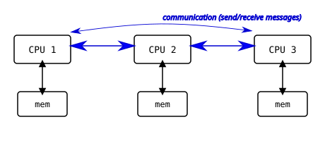

# Intro to Parallel Computing

---

## Announcements

- Course outline is on OWL; make sure you have access.
- We will use C/C++ and MPI in this course, so you need access to a computer running these.
- A Linux-like environment is needed.
- WSL (Windows Subsystem for Linux) should work for program development if you install the MPI runtime & developer packages in setup.
- On Macs, you can probably get by using the XCode package. There is also an MPI implementation you will need.
- There are some tips on OWL in the "Set-Up" file.
- You need to get a SharcNet account → see SharcNet website.
- A line terminal is needed to compile and run code.

---

Back in the day, computers looked like this 

The steering wheel is to play Mario Chariot  — (_not really…_)

### Computer Hardware Evolution

| Year | Machine | CPU | Memory | Notes |
|------|---------|-----|--------|-------|
| 1980 | Commodore VIC 20 | 1 MHz | 5 kByte RAM, 20 kByte ROM | — |
| 1995 | Gateway Pentium PC | 100 MHz (×100) | 4 MByte | Clock speed is 100 times faster than 1980 |
| 2005 | Dell Pentium PC | 2 GHz (×200) | 1 GByte | Clock speed is 20 times faster than 1995 |
| 2015 | Lenovo i7 PC | 4× 3 GHz (×1.5) | 4 GByte | Clock speed is only 1.5 times faster than 2005 BUT now we have 4 processors (multicore) and a GPU: 1526× 1 GHz (Nvidia GeForce 770) — *The 1526 cores on the gpu is by far the biggest improvement* |

Conclusion: To run code faster we cannot rely on hardware improvements of serial processors, we must take advantage of the multicore CPU and GPU which means we need to parallelize our code.

### Reasons to Parallelize

- **Time** (clock time) by dividing up the work hopefully more processors working will reduce the (wall) time to run code
- **Memory** by dividing up the work, each process may be able to use less memory to solve a smaller part of the problem

---

## Classification of Parallelization

### By Data & Instruction Schemes

|  |  Same Data | Multiple Data |
|--|-----------|---------------|
|  **Single Instruction** | SISD (_serial_) |  SIMD |
|  **Multiple Instructions** |  MISD |  MIMD |

> **Note:** Different computer architectures may be required for different schemes, but some architectures can run different schemes.

---

### Example ① — SISD: Single Instruction Same Data (Serial)

Compute $\displaystyle F_1 = \sum_{n=1}^N f_n$

**Algorithm** (sequential in time ↓):

$$
\begin{aligned}
F_1 &= f_1 \\
F_1 &\mathrel{+}= f_2 \\
F_1 &\mathrel{+}= f_3 \\
&\;\vdots \\
F_1 &\mathrel{+}= f_N
\end{aligned}
$$

---

### Example ② — SIMD: Single Instruction Multiple Data

Compute $A = 4 \cdot B$ where $A$, $B$ are arrays of length $n$, with $n$ divisible by 3.

**Algorithm** — three CPUs work in parallel (time ↓):

| CPU 1 | CPU 2 | CPU 3 |
|-------|-------|-------|
| `A[1] = 4*B[1]` | `A[2] = 4*B[2]` | `A[3] = 4*B[3]` |
| `A[4] = 4*B[4]` | `A[5] = 4*B[5]` | `A[6] = 4*B[6]` |
| ⋮ | ⋮ | ⋮ |
| `A[n-2] = 4*B[n-2]` | `A[n-1] = 4*B[n-1]` | `A[n] = 4*B[n]` |

_The division of data is clearly not unique. Different divisions may result in faster/slower code._

---

### Example ③ — MISD: Multiple Instruction Same Data

Moments Problem: Compute $\displaystyle F_\mu = \dfrac{1}{N} \sum_{n=1}^N f_n^\mu$ for $\mu=1,2,...,M$

**Algorithm** — $M$ CPUs, each computing a different power sum (time ↓):

| CPU 1 | CPU 2 | $\cdots$ | CPU M |
|-------|-------|----------|-------|
| $F_1 = f_1$ | $F_2 = f_1^2$ | $\cdots$ | $F_M = f_1^M$ |
| $F_1 \mathrel{+}= f_2$ | $F_2 \mathrel{+}= f_2^2$ | $\cdots$ | $F_M \mathrel{+}= f_2^M$ |
| $F_1 \mathrel{+}= f_3$ | $F_2 \mathrel{+}= f_3^2$ | $\cdots$ | $F_M \mathrel{+}= f_3^M$ |
| $\vdots$ | $\vdots$ | $\cdots$ | $\vdots$ |
| $F_1 \mathrel{+}= f_N$ | $F_2 \mathrel{+}= f_N^2$ | $\cdots$ | $F_M \mathrel{+}= f_N^M$ |

---

### Example ④ — MIMD: Multiple Instruction Multiple Data

Different CPUs have different tasks and act on different data sets.

| CPU 1–10 | CPU 11–20 |
|----------|-----------|
| Solve diffusion equation and write data at each time step to a file | Analyze output files to calculate toxicity at a given location |

---

## Classification of Parallel Computing by Memory

### Shared Memory (_typical desktop today_)


### Distributed Memory (_classic Beowulf cluster_)



In practice, most systems today are some combination. However, it is useful to develop algorithms based on a single paradigm in order to make portable code.

MPI is based on a distributed memory paradigm. It provides a library of functions to facilitate communication between processors.

$$
\text{MPI} = \left\{ \begin{array}{l} \text{Message} \\ \text{Passing} \\ \text{Interface} \end{array} \right.
$$

---

## MPI

The MPI Library consists of more than 100 functions.  Of these, 6 functions are really important:

1. Initialize MPI
2. Find # of processes (specified when program submitted)
3. Find out which process I am
4. Send a message → _main point of library_
5. Receive a message ← _main point of library_
6. Terminate MPI.  This is _essential — **always** do this! MPI is C-based, not C++_

### Example: "Hello World" in C
```c
#include <stdio.h>
#include "mpi.h"        /* MPI header files — always need this */

main(int argc, char** argv)
{
    int noprocs, nid;

    MPI_Init(&argc, &argv);                       /* starts MPI and code
                                                     communications on all processors */
    /* The following commands now run on each node independently */
    MPI_Comm_size(MPI_COMM_WORLD, &noprocs);   
    MPI_Comm_rank(MPI_COMM_WORLD, &nid);       

    printf("Hello from processor %i of %i\n", nid, noprocs);

    MPI_Finalize();     /* close off all the processes */
}
```

**Comments:**

- `MPI_Init` must be called **exactly once** before all other MPI commands.
- `MPI_Finalize` should be called after all other MPI commands.
- `MPI_Comm_size` finds out the number of processors (stored in `noprocs`).
- `MPI_Comm_rank` finds out which process I am; $nid \in \{0, \ldots, nprocs - 1\}$.
- `MPI_COMM_WORLD` is an MPI "communicator".

### Flowchart of What Happens


Note that once multiprocesses are running they are **independent** and variables like `"nid"` are **different** for each process.

The `printf` statement is executed on each processor independently (as are the previous 2 commands), and there is a different local version of `nid` and `noprocs` on each processor, potentially with different values.

The different processes are not typically in sync, so the output may come in any order and be different if you run the code again.

**Typical compile line:**

```sh
mpicc -o hello.o hello.c
```

**Typical run command** _(specify # of processes, 4 in this example)_:

```sh
mpirun -np 4 ./hello.o
```

**Expected output** _(perhaps not in this order)_:

```
Hello from processor 0 of 4
Hello from processor 1 of 4
Hello from processor 2 of 4
Hello from processor 3 of 4
```

---

MPI is a library written in C. It also has a Fortran version interface. There was a long-term effort to get a C++ version but it was buggy, largely shunned in favour of the C version, and was abandoned as unnecessary (C++ can just use the C library).

For C++ it is always a good idea to try to follow the RAII paradigm and try to automate cleanup using class destructors to take care of it. To make our C and C++ code as similar as possible, we will first rewrite `hello.c` to put MPI variables into a data structure and add a startup function.

### Refactored C Version

```c
#include <stdio.h>
#include "mpi.h"

struct mpi_vars {   /* data structure type declaration */
    int NProcs;
    int MyID;
};

struct mpi_vars mpi_start(int argc, char** argv)
{
    struct mpi_vars this_mpi;

    MPI_Init(&argc, &argv);
    MPI_Comm_size(MPI_COMM_WORLD, &this_mpi.NProcs);
    MPI_Comm_rank(MPI_COMM_WORLD, &this_mpi.MyID);

    return this_mpi;
}

int main(int argc, char** argv)
{
    /* initialize MPI data structure using start function */
    struct mpi_vars this_mpi = mpi_start(argc, argv);

    printf("Hello from processor %i of %i\n",
           this_mpi.MyID, this_mpi.NProcs);

    MPI_Finalize();
    return 0;
}
```

**Notes:**

1. Only **one** instance of `mpi_vars` should be created (on each MPI thread).
2. The `mpi_start` function should only ever be called **once**.
3. In C, `MPI_Finalize()` should **always** be called before you exit the program.

### C++ Version (RAII)

Translation of this to C++ is then very straightforward:

```cpp
#include <iostream>
#include "mpi.h"

class MPI_stuff
{
public:
    /* The variables we had in a mpi_vars struct in the C version: */
    int NProcs; 
    int MyID;

    /* put MPI initialization into class constructor */
    MPI_stuff(int &argc, char** &argv)
    {
        MPI_Init(&argc, &argv);
        MPI_Comm_size(MPI_COMM_WORLD, &NProcs);
        MPI_Comm_rank(MPI_COMM_WORLD, &MyID);
    }

    /* put MPI cleanup into class destructor */
    ~MPI_stuff()
    {
        MPI_Finalize();
    }
};

int main(int argc, char** argv)
{
    /* MPI will be started automatically by the MPI_stuff constructor */
    MPI_stuff the_mpi(argc, argv);

    std::cout << "Hello from processor " << the_mpi.MyID
              << " of " << the_mpi.NProcs << std::endl;

    /* the_mpi variable goes out of scope here,
       so the destructor will be called to close off MPI */
    return 0;
}
```

**Notes:**

1. The class `MPI_stuff` should only ever have **one** instance in existence (but this one instance may/will have different values for `MyID` on each processor).
2. `MPI_Finalize` will automatically be called when `the_mpi` variable goes out of scope (useful if the program exits in an unexpected manner too).
3. Compilation is typically something like `mpiCC -o hello.o hello.cpp` _(note: capital C's)_.

---

> **"Homework"**
>
> 1. Sign up for a Digital Research Alliance of Canada (DRA) account and online "training seminar".
> 2. Try to get Hello World running on your machine.
> 3. Try to get Hello World running on a DRA cluster
