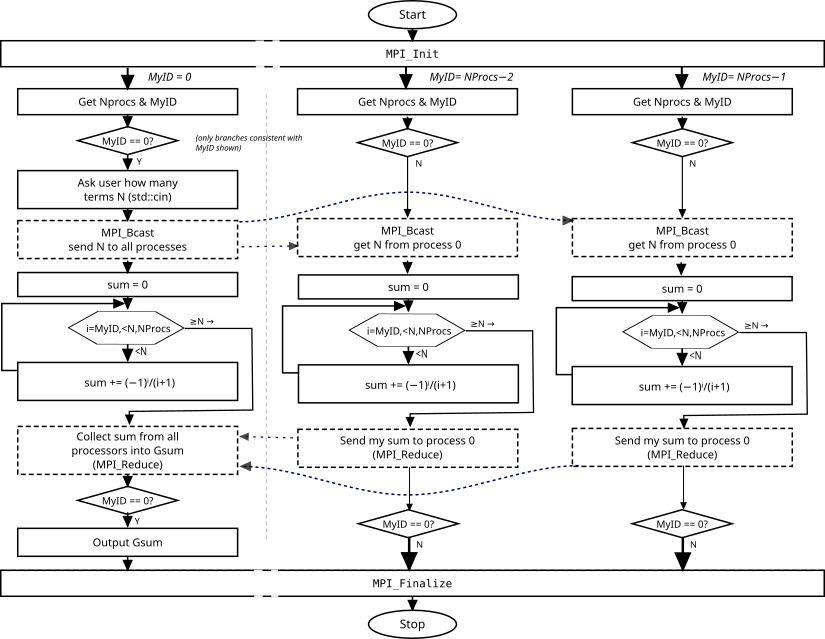
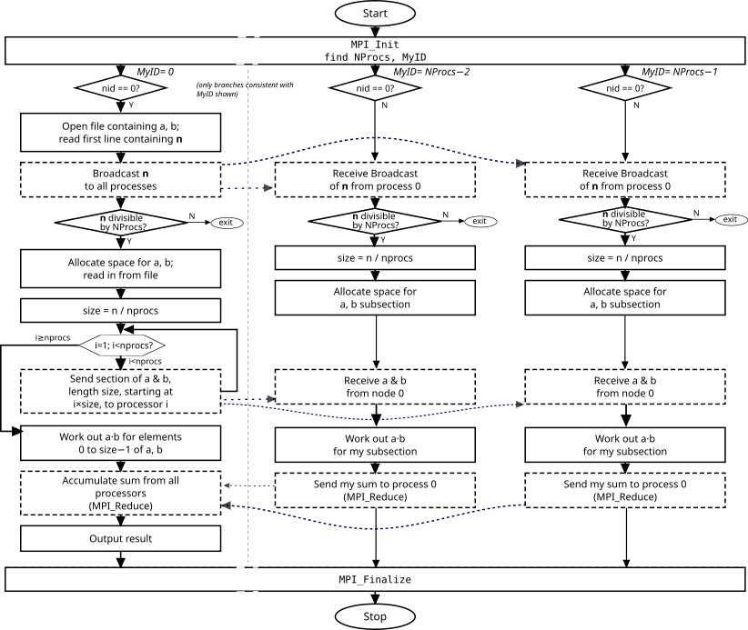
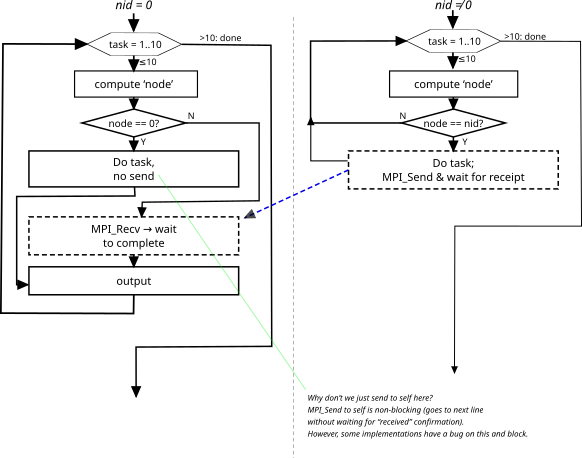

# Message Passing between Processes

---

## Passing Data

Two main paradigms for sharing data between MPI processes:

- **One-to-all (broadcast):** one node sends the same data to all others → `MPI_Bcast`
- **All-to-one (reduce):** each node contributes data that is combined on one node → `MPI_Reduce`

### Example: Computing ln 2

Consider the formula for computing $\ln 2$ from a series:
$$\ln 2 = \sum_{n=1}^{\infty} \frac{(-1)^{n+1}}{n} = 1 - \frac{1}{2} + \frac{1}{3} - \frac{1}{4} + \cdots$$
We want to compute this by dividing the terms to be computed amongst the processors.  Obviously we can't go to $\infty$ so we will terminate the sum at $N$ terms.  If there are `NProcs` processors with IDs $0, 1, \ldots, \text{NProcs}-1$, then processor `nid` handles the terms where $i = \text{nid}, \text{nid}+\text{NProcs}, \text{nid}+2\cdot\text{NProcs}, \ldots$ .  The sum above starts at 1 rather than 0 so it makes sense to first shift to zero-based indexing, so the $n$-th term is $(-1)^n/(n+1)$).  Mathematically we can rewrite the sum as:
$$\ln 2 = \sum_{n=1}^{\infty} \frac{(-1)^{n+1}}{n} = \lim_{N\rightarrow\infty}  \sum_{n=0}^{N} \frac{(-1)^{n}}{n+1}=\sum_{n_{id}=0}^{N_{Procs}-1}\left(\sum_{i=n_{id},N_{Procs}}^N \frac{(-1)^{i}}{i+1}\right)$$
where in the inner sum, the $N_{Procs}$ is the increment for $i$.  Each processor works on one inner loop and then at the end we will need to collect and sum the results from each processor.  For example with `NProcs = 2`:

| $i$ | $(-1)^i/(i+1)$ | processor |
|-----|-----------------|-----------|
| 0   | $+1/1$          | nid = 0   |
| 1   | $-1/2$          | nid = 1   |
| 2   | $+1/3$          | nid = 0   |
| 3   | $-1/4$          | nid = 1   |
| ... | ...             | ...        |

Note that processor nid = 0 always handles even-indexed terms (positive) and nid = 1 always handles odd-indexed terms (negative) — provided `NProcs` is even. In general, for even `NProcs`, processors with an even ID always add their terms and processors with an odd ID always subtract, so the sign can be determined from `MyID` alone, without checking `i` inside the loop.

---

## Boss-Worker Model

The Boss-Worker pattern is the standard structure for MPI programs:

- **Node 0** is designated the **Boss** (it does all I/O, since multiple processes cannot, for example, safely access the same file simultaneously).
- All other nodes are **Workers**.
- The Boss reads input (or asks the user), then broadcasts it to all workers via `MPI_Bcast`.
- Every processor (Boss and Workers) works on its own set of terms: Boss handles $n = 0, \text{NProcs}, 2\cdot\text{NProcs}, \ldots$; Worker 1 handles $n = 1, 1+\text{NProcs}, \ldots$; etc.
- Partial results are collected (reduced) back to the Boss via `MPI_Reduce`.

---

## C++ Implementation: ln 2

```cpp
#include <iostream>
#include "mpi.h"

/* MPI_stuff is same as class from helloworld code in last lecture */
class MPI_stuff {
public:
    int NProcs;
    int MyID;
    MPI_stuff(int& argc, char**& argv) {
        MPI_Init(&argc, &argv);
        MPI_Comm_size(MPI_COMM_WORLD, &NProcs);
        MPI_Comm_rank(MPI_COMM_WORLD, &MyID);
    }
    ~MPI_stuff() { MPI_Finalize(); }
};

/* This function actually computes the sum
float compute_lnsum(const MPI_stuff& the_mpi, const int N)
{
    float sum = 0, Gsum;
    /* processor MyID handles terms i = MyID, MyID+NProcs, MyID+2*NProcs, ... */
    for (int i = the_mpi.MyID; i < N; i += the_mpi.NProcs) {
        /* for even NProcs: even-ID procs handle even i (positive), odd-ID handle odd i (negative) */
        if (the_mpi.MyID % 2)
            sum -= (float)1 / (i + 1);
        else
            sum += (float)1 / (i + 1);
    }

    /* Now we need to collect and sum the results from each processor using MPI_Reduce */
    MPI_Reduce(&sum, &Gsum, 1, MPI_FLOAT, MPI_SUM, 0, MPI_COMM_WORLD);
    
    return Gsum; //the answer
}

int main(int argc, char** argv)
{
    MPI_stuff the_mpi(argc, argv);

    if (the_mpi.NProcs % 2 != 0) {
        std::cout << "Program only works for an even number of processors" << std::endl;
        return 0;
    }
    
    int N;
    if (the_mpi.MyID == 0) {          /* Boss asks the user for N */
        std::cout << "Please enter the number of terms N -> ";
        std::cin >> N;
    }

    MPI_Bcast(&N, 1, MPI_INT, 0, MPI_COMM_WORLD);   /* send N to everyone */

    float Gsum = compute_lnsum(the_mpi, N);

    /* Boss outputs the result
    if (the_mpi.MyID == 0)
        std::cout << "An estimate of ln(2) is " << Gsum << std::endl;

    return 0;
}
```

### Flowchart



We have omitted the check that `NProcs` is even in the flowchart and the black dashed lines indicate processes not shown (only the $0^{th}$ and last highest two processes are shown).  The blue dotted lines indicate communication between the processes.  

---

### MPI Function Signatures

**`MPI_Bcast`** — broadcast from root to all processes:

```c
MPI_Bcast(&N,               1,       MPI_INT,        0,       MPI_COMM_WORLD);
//         ↑                ↑          ↑             ↑            ↑
//    pointer to start   buffer     data type     sending     "communicator"
//    of data buffer     size       being sent    processor   data structure
//    to send                                        ID       for who is involved
//                                                            (everyone here)
```

**`MPI_Reduce`** — combine values from all processes onto root:

```c
MPI_Reduce(&sum,      &Gsum,    1,     MPI_FLOAT,  MPI_SUM,       0,       MPI_COMM_WORLD);
//          ↑            ↑      ↑         ↑          ↑           ↑              ↑
//      send_buffer recv_buf  buffer  data type  operation   receiving     communicator
//                             size                         processor ID
```
Here the Reduce operation performs a sum on all the values received from the different processors (values from `sum`) and puts the resulting sum in `Gsum`.

**Note:** `N` does not have to be a multiple of `NProcs`. When it is not, some processors will simply have slightly less work — the `for` loop terminates naturally when `i ≥ N`. No zero-padding is required. Passing large contiguous blocks of data (rather than individual elements) is much more efficient for MPI communication.

---

## Arrays in MPI

So far we have just passed data of a simple fundamental type.  To pass larger blocks of data we first need to consider how they are stored in C as the MPI library is written in C.

### C-Style 1D Arrays

A declration like
`double a[100];`
creates a C-style array (also in C++) where each element is laid out contiguously in memory.  We can illustrate for an array of length `n` as:


Note that the allowed entries are $0,...,n-1$, i.e. they always start at zero.  The size (in memory) of each box is `sizeof(double)` = 64 bits for an array of `double` .  In order to send an array from one process to anothe we need to know where it starts in memory (it's address) and its size.  An important identity in C: the array name **is** the address of its first element.  For example:
```cpp
#include <iostream>

int main() { 
    int array[5] = { 9, 7, 5, 3, 1 }; 
    
    // print the value of the array variable 
    std::cout<< "The array has address: "<< array << '\n'; 
    
    // print address of the array elements 
    std::cout<< "Element 0 has address: "<< &array[0] << '\n'; 
    
    return 0; 
}
```
will produce an output something like

`The array has address: 0042FD5C 
Element 0 has address: 0042FD5C
`
Note that both give the address of the first element.

In C, dynamic allocation of arrays typically uses `malloc` or `calloc`. The second is preferable as it also initializes the elements (to zero).  e.g.
```c
float *a;
a = (float*) calloc(n, sizeof(float));   /* allocate n floats, zero-initialised */
```
As with statically declared arrays, this creates an array of size `n` (an integer) doubles.  

This means you can pass `&array[k]` to `MPI_Send`/`MPI_Recv` to start the transfer at any element — a convenient way to send a sub-section of an array. Data sizes to keep in mind:

- `sizeof(float)`  = 32 bits
- `sizeof(double)` = 64 bits

> **Warning:** C arrays do **not** perform bounds checking. Accessing `a[-1]` or `a[n]` causes undefined behaviour with no error raised.

### MPI Data Types
To ensure compatible sizes across a potentially heterogeneous environment, MPI introduces its own fundamental data types that you should use in MPI functions.
| MPI type | C type |
|----------|--------|
| `MPI_INT` | `int` |
| `MPI_FLOAT` | `float` |
| `MPI_DOUBLE` | `double` |
| `MPI_CHAR` | `char` |

### Using `std::vector` (C++)

In C++ we can create dynamically allocated arrays using `new[]` and `delete[]`, but this is no longer recommended (it will be made obsolete in future versions of C++). The preferred replacement is `std::vector`.

`std::vector` manages memory automatically and is safer than raw C arrays. It has two separate size concepts:

- **capacity** — the amount of memory currently reserved (set by `reserve`)
- **size** — the number of elements actually in use (set by `resize`)

```cpp
std::vector<float> a;
a.reserve(n);    /* allocate memory for n elements (capacity = n, size = 0) */
a.resize(n);     /* now size = n; new elements are zero-initialised */

/* Or in one step: */
std::vector<float> a(n);   /* capacity = size = n, zero-initialised */
```
These create an array with similarites (and differences) to what we did in C.  Importantly, the elements `a[0], a[1],...` are stored consecutively in memory, which is vitally important for using MPI (and performance in general).  For a C++ vector, the name is _no longer_ the address of the first element of the array (i.e. `&a[0] ≠ a`).  There is also the issue that the array could have no reserved capacity if it was not constructed with a size origianally.

**Important (Compute Canada / HPC advice):** Do **not** use `push_back` in performance-critical code. `push_back` can trigger reallocation and copying of the entire array. Use `reserve` + `resize` (or construct with a size) instead.

If you need to use a pointer to the array even in the case it could be empty, using the `.data()` member function is always safe as it will return `nullptr` in the case there is nothing allocated (but generally avoid creating empty vectors).

For bounds-checked access, use `.at(i)` instead of `operator[]`:
```cpp
a.at(i) = 3.14f;   /* throws std::out_of_range if i is out of bounds */
a[i]    = 3.14f;   /* no bounds check — same risk as a C array */
```

---

## One-to-One Communication: Dot Product

Let's look at how we would comput the dot product of two vectors of length $n$: 

$\displaystyle\vec{a} \cdot \vec{b} = \sum_{i=1}^{n} a_i b_i=\sum_{i=0}^{n-1}$`a[i]b[i]`

Let's assume we have `NProcs` processors and that `n` is exactly divisible by  `NProcs`.  We can then break the task into parts of 
$$size=\frac{n}{N_{procs}}$$
Anticipating a SIMD scheme, we rewrite the sum as:

$\displaystyle\vec{a} \cdot \vec{b} = \sum_{i=0}^{n-1}$ `a[i]b[i]`$\displaystyle=\sum_{i=0}^{size-1}$`a[i]b[i]` $\displaystyle+ \sum_{i=size}^{2 size-1}$`a[i]b[i]`$\displaystyle+ ... +\sum_{i=(N_{procs}-1)size}^{n-1}$`a[i]b[i]`

and processor `j` works on a contiguous block of `size = n/NProcs` elements starting at index `j × size`:

$$\text{processor } j \text{ handles } a[j \cdot \text{size}] \ldots a[(j+1)\cdot\text{size} - 1]$$

To summarize, we distribute the arrays across `NProcs` processors using a SIMD-style split: each processor receives a contiguous block of `size = n/NProcs` elements, computes a local dot product, then the partial sums are reduced (summed) to the Boss process.

### Flowchart



---

### C++ Implementation: Dot Product

```cpp
#include <iostream>     /* regular I/O */
#include <fstream>      /* file stream header for functions interacting with files */
#include <vector>       /* needed for std::vector */
#include "mpi.h"

/* MPI_stuff class should come here— same as above */

// Function to get the number of rows of data in the file from first row of file
int GetNumberElements(std::ifstream& fin)
{
    int n;
    if (fin.is_open())
        fin >> n;
    else {                                      /* no file to read from */
        std::cout << "Input File not found\n";
        MPI_Abort(MPI_COMM_WORLD, -2);
    }
    return n;
}

// Function to read n elements of two column data from a file, store in arrays a,b
void ReadArrays(std::ifstream& fin, std::vector<float>& a,
                std::vector<float>& b, int n)
{
    if (fin.is_open()) {
        for (int i = 0; i < n; i++)
            fin >> a[i] >> b[i];
    } else {                                    /* fp null means no file to read from */
        std::cout << "Input File not found\n";
        MPI_Abort(MPI_COMM_WORLD, -2);
    }
}

// Function to compute dot product of two vectors owned and fully stored on Boss node
// but subdivded amongst avaialble processors which individually compute the dot product
// of their subsections.
float DotProduct(std::vector<float>& a, std::vector<float>& b,
                 int size, MPI_stuff& mpi)
{
    MPI_Status status;

    if (mpi.MyID == 0) {
        /* Boss sends each worker its chunk of both arrays */
        for (int i = 1; i < mpi.NProcs; i++) {
            MPI_Send(&a[size*i], size, MPI_FLOAT, i, 10, MPI_COMM_WORLD);
            MPI_Send(&b[size*i], size, MPI_FLOAT, i, 20, MPI_COMM_WORLD);
        }
    } else {
        /* Workers receive their chunks */
        MPI_Recv(&a[0], size, MPI_FLOAT, 0, 10, MPI_COMM_WORLD, &status);
        MPI_Recv(&b[0], size, MPI_FLOAT, 0, 20, MPI_COMM_WORLD, &status);
    }

    /* Each node computes its local dot product */
    float local_sum = 0.0f;
    for (int i = 0; i < size; i++)
        local_sum += a[i] * b[i];

    /* Reduce partial sums to Boss */
    float global_sum = 0.0f;
    MPI_Reduce(&local_sum, &global_sum, 1, MPI_FLOAT, MPI_SUM, 0, MPI_COMM_WORLD);
    return global_sum;
}


int main(int argc, char** argv)
{
    MPI_stuff the_mpi(argc, argv);

    std::ifstream fin;
    int n = 0;

    if (the_mpi.MyID == 0) {
        fin.open("DotData.txt");          /* only Boss reads from file */
        n = GetNumberElements(fin);       /* (multiple processes cannot access file simultaneously) */
    }
    MPI_Bcast(&n, 1, MPI_INT, 0, MPI_COMM_WORLD);   /* send n to everyone */

    if (n % the_mpi.NProcs) {            /* is n divisible by NProcs? */
        std::cout << "Number of processes is not a multiple of n.\n";
        MPI_Abort(MPI_COMM_WORLD, -2);   /* kills program gracefully on all nodes */
    }

    int size = n / the_mpi.NProcs;

    std::vector<float> a, b;
    if (the_mpi.MyID == 0) {
        a.reserve(n);  a.resize(n);      /* node 0 stores the full arrays */
        b.reserve(n);  b.resize(n);
        ReadArrays(fin, a, b, n);        /* node 0 reads from file */
    } else {
        a.reserve(size);  a.resize(size);  /* workers only need smaller array for their chunk */
        b.reserve(size);  b.resize(size);
    }

    float adotb = DotProduct(a, b, size, the_mpi);   /* compute a·b */

    if (the_mpi.MyID == 0)
        std::cout << "The inner product is " << adotb << std::endl;

    return 0;
}
```

---

### `MPI_Send` and `MPI_Recv`

```c
MPI_Send(&a[size*i],   size, MPI_FLOAT,     i,      10,   MPI_COMM_WORLD);
//        ↑             ↑       ↑          ↑        ↑           ↑
//   ptr to buffer    count    type    processor   tag       communicator
//   (beginning of   (buffer           to send to  (match
//    buffer to send)  size)                        to RecV)

MPI_Recv(&a[0],      size, MPI_FLOAT,  0,      10, MPI_COMM_WORLD, &status);
//        ↑           ↑       ↑        ↑       ↑       ↑               ↑
//   ptr to recv   count    type    source     tag  communicator      status
//   buffer                         of message
```

### Design Comments

1. The **tag** in `MPI_Send` must match the tag in the corresponding `MPI_Recv`. Use a different tag for each distinct message type — here tag `10` is used for the `a` array and tag `20` for the `b` array.

2. The `n % NProcs != 0` condition causes `MPI_Abort`. In the dot product case, `n` must be divisible by `NProcs`. 

3. The Boss uses more memory than the Workers (it has to store the full arrays `a` and `b`). A better approach: have the Boss read and send segments one at a time — it reads a segment, sends it to worker `i`, reads the next segment, sends it to worker `i+1`, etc., and then works on the last segment (segment `NProcs − 1`) itself. This also resolves issue 2: `n` no longer needs to be a multiple of `NProcs` (the last segment simply absorbs the remainder).

4. Potential crash points (e.g. file not found, wrong input) should call `MPI_Abort(MPI_COMM_WORLD, -2)` so that **all** MPI processes are killed cleanly — not just the one that detected the error.

---

## Summary of MPI Commands Encountered So Far

```c
MPI_Init(&argc, &argv);
MPI_Finalize();
MPI_Abort(MPI_COMM_WORLD, -1);

MPI_Comm_size(MPI_COMM_WORLD, &nprocs);
MPI_Comm_rank(MPI_COMM_WORLD, &myrank);

MPI_Bcast(&N,    1, MPI_INT,   0, MPI_COMM_WORLD);
MPI_Reduce(&sum, &Gsum, 1, MPI_FLOAT, MPI_SUM, 0, MPI_COMM_WORLD);

MPI_Send(&a[size*i], size, MPI_FLOAT, i,  10, MPI_COMM_WORLD);  /* tag 10 for a */
MPI_Send(&b[size*i], size, MPI_FLOAT, i,  20, MPI_COMM_WORLD);  /* tag 20 for b */
MPI_Recv(&a[0],      size, MPI_FLOAT, 0,  10, MPI_COMM_WORLD, &status);
MPI_Recv(&b[0],      size, MPI_FLOAT, 0,  20, MPI_COMM_WORLD, &status);
```

---

## `MPI_Allreduce`

A variant of `MPI_Reduce` that distributes the result to **all** processors (All-to-All communication):

```c
MPI_Allreduce(&maxerr, &maxerrG, 1, MPI_FLOAT, MPI_MAX, MPI_COMM_WORLD);
```

Here `maxerr` is reduced (e.g. finding the global maximum across all processors) and the result `maxerrG` is available on every processor — not only on one specific node.

### Reduction Operations

The `op` argument accepted by `MPI_Reduce`, `MPI_Allreduce`, `MPI_Reduce_scatter`, and `MPI_Scan`:

| Operation | Meaning |
|-----------|---------|
| `MPI_MAX` | maximum |
| `MPI_MIN` | minimum |
| `MPI_SUM` | sum |
| `MPI_PROD` | product |
| `MPI_LAND` | logical and |
| `MPI_BAND` | bit-wise and |
| `MPI_LOR` | logical or |
| `MPI_BOR` | bit-wise or |
| `MPI_LXOR` | logical xor |
| `MPI_BXOR` | bit-wise xor |
| `MPI_MAXLOC` | max value and location |
| `MPI_MINLOC` | min value and location |

*(Source: OpenMPI docs — https://www.open-mpi.org/doc/v3.0/man3/MPI_Reduce.3.php)*

---

## `MPI_Status`

Before going on, let's discuss the status variable in the `MPI_Recv` call.  `MPI_Status` is a data structure type with fields:

```c
MPI_Status status;
status.MPI_SOURCE   /* id of the processor that sent the message */
status.MPI_TAG      /* the message tag */
status.MPI_ERROR    /* error status (often not modified; same as function return value) */
/* other fields possible but implementation-dependent */
```

`status.MPI_SOURCE` is particularly useful when receiving with `MPI_ANY_SOURCE` — it tells you which processor the message actually came from.

---

## Controlling Synchronisation: Blocking vs Non-Blocking Communication

`MPI_Send` is a **blocking** routine: the sending processor waits for a "received" confirmation before proceeding to the next line of code. Similarly, `MPI_Recv` causes the receiving processor to block until the message arrives. 

## Example: Task Distribution

Suppose we have 10 tasks numbered 1 to 10 to distribute across `nprocs = 4` processors with $\mathit{nid} \in \{0, 1, 2, 3\}$.

```c
int node, nprocs;
 ...

for (int task=1; task <= 10; task++) {
    node = task - nprocs * (task/nprocs);   /* integer arithmetic — equivalent to task % nprocs */
    ...
}
```
| task | task/nprocs | node |
|------|-------------|------|
| 1 | 0 | 1 |
| 2 | 0 | 2 |
| 3 | 0 | 3 |
| 4 | 1 | 0 |
| 5 | 1 | 1 |
| 6 | 1 | 2 |
| 7 | 1 | 3 |
| 8 | 2 | 0 |
| 9 | 2 | 1 |
| 10 | 2 | 2 |

### Code (C with `mpi_vars` struct)

```c
#include <stdio.h>
#include "mpi.h"

/* mpi_vars struct and mpi_start() would go here — see Ch1 refactored C version */

main(int argc, char** argv)
{
    struct mpi_vars this_mpi = mpi_start(argc, argv);
    MPI_Status status;
    int task, taskx, node;

    for (task=1; task <= 10; task++) {
        node = task - this_mpi.NProcs*(task/this_mpi.NProcs);  /* see which node does this task */

        if (node == this_mpi.MyID && node != 0) {    /* my task, and I'm not the Boss */
            if (node==2) waste_your_time();           /* some slow function */
            MPI_Send(&task, 1, MPI_INT, 0, 10, MPI_COMM_WORLD);   /* tell Boss I am the one */
        }
        if (this_mpi.MyID == 0) {
            if (node == 0)
                printf("Processor %d will compute %d\n", 0, task);
            else {
                /* receive a message from anyone */
                MPI_Recv(&taskx, 1, MPI_INT, MPI_ANY_SOURCE, 10, MPI_COMM_WORLD, &status);
                printf("Processor %d will compute %d\n", status.MPI_SOURCE, taskx);
                /*                                       ↑ node the message actually came from */
            }
        }
    }

    for (task=11; task <= 20; task++) {
        node = task - this_mpi.NProcs*(task/this_mpi.NProcs);

        if (node == this_mpi.MyID && node != 0) { /* Is this is my task? */
            if (node==2) waste_your_time();
            MPI_Send(&task, 1, MPI_INT, 0, 10, MPI_COMM_WORLD); /* tell Boss I am the one */
        }
        if (this_mpi.MyID == 0) {
            if (node == 0)
                printf("Processor %d will compute %d\n", 0, task);
            else {
                MPI_Recv(&taskx, 1, MPI_INT, MPI_ANY_SOURCE, 10, MPI_COMM_WORLD, &status);
                printf("Processor %d will compute %d\n", status.MPI_SOURCE, taskx);
            }
        }
    }
    MPI_Finalize();
}
```

### Sample Output

```
Processor 1 will compute 1
Processor 1 will compute 5
Processor 1 will compute 9
Processor 1 will compute 13
Processor 1 will compute 17
Processor 3 will compute 3
Processor 3 will compute 7
Processor 3 will compute 11
Processor 3 will compute 15
Processor 3 will compute 19
Processor 0 will compute 4
Processor 0 will compute 8
Processor 0 will compute 12
Processor 2 will compute 2
Processor 2 will compute 6
Processor 0 will compute 16
Processor 2 will compute 10
Processor 2 will compute 14
Processor 2 will compute 18
Processor 0 will compute 20
```

**Comments:**
1. Tasks are not completed in order (and the order may change on each run).
2. There is no synchronization between loops: some processors are working on the second loop while other processors are still working on the first loop. 
3. Node 2 is slow, as expected, because of the `waste_your_time()` call.
4. Node 0 is slower because it is busy receiving results from other processors and outputting.
5. Nodes 1 and 3 finish all their tasks before nodes 0 and 2 finish even their first — they complete both loops before nodes 0 and 2 get through the first.

### Flowchart (1st Loop)
To better understand the code, let's look at a flowchart of the first loop:



If we need to have all of tasks 1-10 complete _before_ going on to the 11-20 tasks, we need to synchronize the threads.  This can be cone with a `MPI_Barrier` line between the loops:

## `MPI_Barrier`

```c
MPI_Barrier(MPI_COMM_WORLD);
```
This function blocks the calling process from proceeding until **all** processes in `MPI_COMM_WORLD` have made a similar call. Adding `MPI_Barrier` between the two task loops ensures all tasks 1–10 are complete before tasks 11–20 begin.

### Sample Output (with `MPI_Barrier` between loops)

```
Processor 1 will compute 1
Processor 3 will compute 3
Processor 1 will compute 5
Processor 3 will compute 7
Processor 1 will compute 9
Processor 0 will compute 4
Processor 2 will compute 2
Processor 0 will compute 8
Processor 2 will compute 6
Processor 2 will compute 10
Processor 1 will compute 13
Processor 3 will compute 11
Processor 1 will compute 17
Processor 3 will compute 15
Processor 3 will compute 19
Processor 0 will compute 12
Processor 0 will compute 16
Processor 2 will compute 14
Processor 2 will compute 18
Processor 0 will compute 20
```

---

## Ordering with Blocking `MPI_Send`

In the task example, the blocking effect of `MPI_Send` and `MPI_Recv` was somewhat ameleorated by having the Boss use `MPI_ANY_SOURCE` to accept data from anyone, regardless of order.   Since `MPI_Send` and `MPI_Recv` are blocking, you can force tasks to arrive in order by using the task number as the tag:
```c
MPI_Send(&task, 1, MPI_INT, 0, 10+node, MPI_COMM_WORLD);  /* tag = 10+node */
...
MPI_Recv(&taskx, 1, MPI_INT, MPI_ANY_SOURCE, 10+node, MPI_COMM_WORLD, &status);
```
Note that this leads to an asymmetry: a Worker does its task and immediately sends; the Boss must wait for a Worker's send before it can proceed. If one Worker is slow, the Boss waits. This leads to a form of implicit synchronisation imposed by blocking sends.  Note that this also blocks the other workers as they are also waiting for an acknowledgment from their Send's which won't be sent until the corresponding `MPI_Recv` by the Boxx.
> **Note:** This will slow things down significantly — a processor that finishes early must now wait for node 0 to receive the previous task before it can proceed. Effectively, tasks are executed sequentially in time, just on different processors.  This effectively eliminates the benefit of parallelism as tasks must now be done sequentially, just on different processors.

---

## Non-Blocking Communication

`MPI_Isend` and `MPI_Irecv` are **non-blocking** variants: the calling processor submits the communication request and immediately proceeds to the next line of code without waiting for delivery confirmation. This allows computation and communication to overlap.

The function signatures are the same as `MPI_Send`/`MPI_Recv` but with an extra `MPI_Request*` argument at the end:

```c
MPI_Request req_send10 = MPI_REQUEST_NULL;
MPI_Request req_recv10 = MPI_REQUEST_NULL;

MPI_Isend(&old[size-1][1], N-1, MPI_FLOAT, nid+1, 10, MPI_COMM_WORLD, &req_send10);
MPI_Irecv(&old[0][1],      N-1, MPI_FLOAT, nid+1, 10, MPI_COMM_WORLD, &req_recv10);

/* ... do other useful work here while the communication is in progress ... */

MPI_Wait(&req_recv10, &status);   /* block until the receive has completed */
```

Key points:

- `MPI_Request` is a type (like `int` or `float`) used to track the status of a non-blocking operation. Declare one for each non-blocking call.
- `MPI_REQUEST_NULL` is the null/default value for an `MPI_Request`. Always initialise request variables to this before use.
- `MPI_Wait` blocks the calling processor until the specified operation has completed. For a receive, this is necessary before the received data can be used. For a send, it is usually not needed (the buffer may be reused safely after the wait, but many programs never wait on sends).
- `MPI_Irecv` + `MPI_Wait` is functionally equivalent to `MPI_Recv`; the advantage of the split form is that you can do useful work between the two calls.

### Revised Task Loop (Non-Blocking `MPI_Isend`)

```c
for (task=1; task <= 10; task++) {
    node = task - this_mpi.NProcs*(task/this_mpi.NProcs);

    if (node == this_mpi.MyID) {
        if (node==2) waste_your_time();
        MPI_Isend(&task, 1, MPI_INT, 0, 10, MPI_COMM_WORLD, &req_send10);
        /* req_send10 previously declared of type MPI_Request */
    }
    if (this_mpi.MyID == 0) {
        req_recv10 = MPI_REQUEST_NULL; /* must set so the later MPI_Wait is not prematurely passed */
        MPI_Irecv(&taskx, 1, MPI_INT, MPI_ANY_SOURCE, 10, MPI_COMM_WORLD, &req_recv10);
        MPI_Wait(&req_recv10, &status);
        printf("Processor %d will compute %d\n", status.MPI_SOURCE, taskx);
    }
}
```

This removes the blocking wait imposed by `MPI_Send`. Workers post their `MPI_Isend` and immediately loop back to check the next task. The Boss posts `MPI_Irecv` then calls `MPI_Wait` to collect each result before printing — but it does not have to wait for the _sender_ to be ready before posting the receive, which reduces idle time compared to the fully blocking version.

### Separating Send and Receive Loops (Boss Avoids Waiting)

To avoid having the Boss wait for others to complete before doing its own task, move the receives into a separate loop:

```c
for (task=1; task <= 10; task++) {
    node = task - this_mpi.NProcs*(task/this_mpi.NProcs);

    if (node == this_mpi.MyID) {  // Check to see if this is my task
        if (node==2) waste_your_time();
        MPI_Isend(&task, 1, MPI_INT, 0, 10, MPI_COMM_WORLD, &req_send10); //Tell Boss I am the one
    }
}

if (this_mpi.MyID == 0) {
    for (task=1; task <= 10; task++) {
        req_recv10 = MPI_REQUEST_NULL;
        MPI_Irecv(&taskx, 1, MPI_INT, MPI_ANY_SOURCE, 10, MPI_COMM_WORLD, &req_recv10);
        MPI_Wait(&req_recv10, &status);
        printf("Processor %d will compute %d\n", status.MPI_SOURCE, taskx);
    }
}
MPI_Barrier(MPI_COMM_WORLD);
/* A good idea to put MPI_Barrier here to prevent messages from the next group
   of tasks being confused with the current group, since MPI_Irecv is very
   non-specific — it accepts messages from MPI_ANY_SOURCE with tag 10.
   The barrier ensures all sends from the first loop are complete before
   any process starts sending messages for the next group. */
```

In this version all Workers post their sends immediately (without waiting for the Boss to receive), so they can all finish their tasks in parallel. The Boss then collects the results in a separate loop at its own pace. The `MPI_Barrier` at the end is essential: without it, some Workers from this group of tasks could still be sending while the Boss has moved on to receiving messages for the next group, causing messages to be misattributed.
