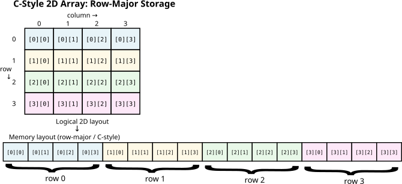
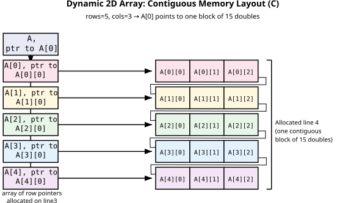
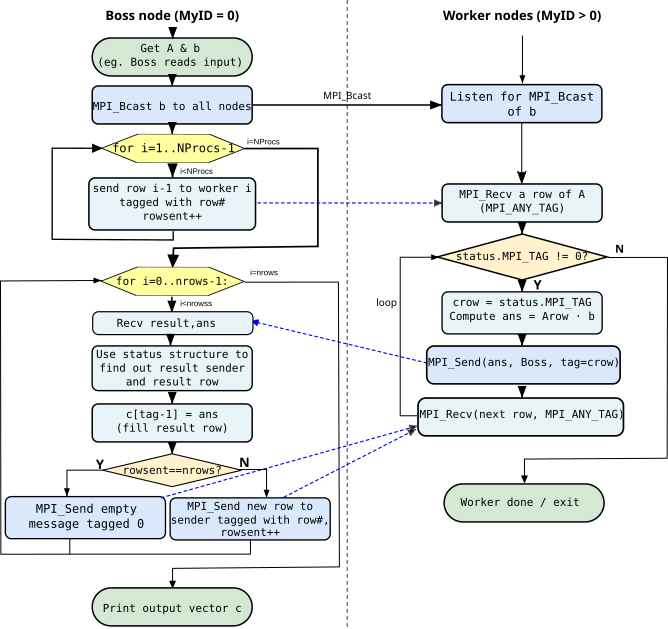
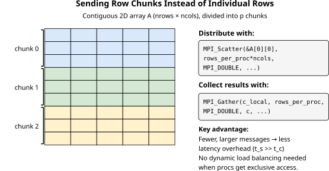
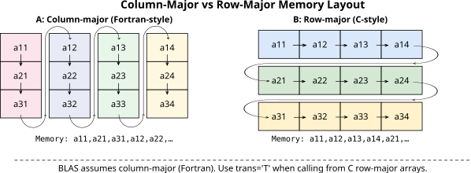

# Chapter 3: Matrix-Vector Operations

---

## Note on Storing Large Arrays

In this section we will look at matrix-vector operations and often will use very large arrays.

If you allocate an array using something like:
```cpp
double a[100000];
```
the array will be stored in something called the **stack**. This is also where the program keeps track of function calls and other code details. Space on the stack is limited, so if you allocate a very large array in this manner you may get a stack "overflow", typically signalled by a "seg fault 11".

If you dynamically allocate memory (through `new` in C++ or `calloc`/`malloc` in C) the array will be stored in something called the **heap**, which does not have space limitations.

Things in the stack can often be accessed faster, so there are cons/benefits to both cases. However, if you arrange the order in which you access elements on the stack, you can often speed up your code by 20–30% due to caching effects. To understand this, and to understand how to send/receive multidimensional arrays using MPI, we need to understand how multidimensional arrays are stored in memory.

---

## C-Style 2D Arrays

Consider a static array declared via:
```c
double array[4][4];
```
We think of this as a matrix, but device memory is addressed in a single linear sequence (i.e. 1D). Therefore, to store this 2D array in memory it must first be converted to a 1D sequence.



C uses **row-major order**: the elements of each row are stored consecutively in memory. The element `array[i][j]` is stored at:

$$\texttt{array[i][j]} \;\longrightarrow\; *\!\bigl(\&\texttt{array[0][0]} + i \times \texttt{ncols} + j\bigr)$$

where `&array[0][0]` is the memory address of the beginning of the array, `ncols` is the number of columns, `(&array[0][0]+i*ncols+j)` is then the memory address of the element in row `i` column `j`, and the `*` operator placed in front of a memory address 'de-references' this address to give you the value that is stored at the memory address.  This means:

$$\texttt{array[i][j]} \;\equiv\; \texttt{array[0][i{*}4 + j]}$$

As there is no bounds checking, you can use either form interchangeably in code.

The compiler actually converts all multidimensional arrays into 1D arrays at compile time, which is why in C you need to pass functions the number of columns in order for the function to decode what you mean by `a[i][j]`.  Note that C puts a significant burden on the programmer to manage memory precisely and without errors.  The failure of programmers to do this consistently is one of the main drivers for creation of so-called "memory-safe" languages like Rust. You must be _extremely_ careful to avoid coding errors and diligently test and debug.

---

## Dynamically Allocated 2D Arrays in C

In order to use external libraries like MPI (and others like the BLAS and LAPACK) we need to ensure dynamically allocated multidimensional arrays break into 1D storage in a manner consistent with a static 2D array.

There are several ways to dynamically allocate multidimensional arrays. Many are **not** consistent with static storage. We will do this so that the entire array is stored in one contiguous block of memory.  There are many reference, like _Numerical Recipies in C_, where the array is not stored in one contiguous block and you should watch for this when parallizing legacy code.

For example:
```c
int rows = 5, cols = 3;
double** A;
A = (double**) calloc(rows, sizeof(double*));    // allocate array of row pointers
A[0] = (double*) calloc(rows*cols, sizeof(double));  // allocate entire data block
for (int i=1; i<rows; i++)
    A[i] = A[i-1] + cols;                     // make A[i] point to start of row i
```



Notes on the pictorial layout:

1. Each `A[i]` is a pointer that points to `A[i][0]`.
2. `A` is a pointer that points to `A[0]`, which is itself a pointer pointing to `A[0][0]`. As such, `A` is a pointer to an array of pointers, each of which points to the beginning of a new row.
3. Note that the actual array data is stored sequentially (all `rows*cols` doubles in one contiguous block), just like a fixed array.

### Deallocation

To deallocate this array, we must do it in **reverse order** from the way we created it with the `calloc` statements:
```c
free(A[0]);  // deallocates actual data array
free(A);     // deallocates array of row pointers
```
If we attempted to deallocate in the opposite order, we would have lost what `A[0]` pointed to (the actual array), and would have a big **memory leak** (i.e. we would no longer have access to the actual data array: it would remain allocated but completly useless and taking up memory space that cannot be reused.)

---

## C++ 2D Arrays

In order for us to use MPI and other external libraries, we need the actual data in our arrays to be stored in memory in the same way as a static multidimensional C array. We can still do this with C++ vectors:
```cpp
int rows = 5, cols = 3;
std::vector<double*> A;
A.reserve(rows);  A.resize(rows);
std::vector<double> Amem;
Amem.reserve(rows*cols);  Amem.resize(rows*cols);
A[0] = &(Amem[0]);
for (int i=1; i<rows; i++) {
    A[i] = A[i-1] + cols;
}
```
This sets up something analogous to what we did in C. We can use `A[i][j]` as if we declared the array statically as `double A[5][3]`.

However, this is obviously less than ideal and makes bounds checking very messy. The C++23 standard introduced  `std::mdspan` as a multidimensional view into a non-owned 1D array but is still not fully implemented into all compilers (as of late 2026). In the meantime, a good way to avoid these problems is to use the Boost libraries.

---

## Boost Multi-Array

**Boost** is a set of libraries that are similar to, and often expand on, the STL. They are close enough to the standard that different parts of Boost have been incorporated into C++11  and later standards (btw, if the code you are working with is not compliant with a version of C++ from 2011 or newer, you should probably start by updating the code to a newer standard).

To use the Boost libraries, we must first install them on our machine using the command line:

- On **Linux/WSL** (Windows Subsytem for Linux (WSL) bash shell): `sudo apt-get install libboost-all-dev`
- On a **Mac**, first install MacPorts from [www.macports.org](http://www.macports.org), then: `sudo port install boost-devel`

You will typically be prompted for a password and then it will install Boost _plus_ anything else you many need to use it on your machine.

On Linux/WSL you should not need to do anything else. In some systems you may have to link when you compile using something like `-lboost_xx` where `xx` is one of the Boost sublibrary names.

### Boost Example

`std::vector` is great for 1-dimensional arrays but does not naturally handle multi-dimensional arrays well. The `boost::multi_array` library provides `std::vector`-like functionality to multidimensional arrays.

```cpp
#include "boost/multi_array.hpp"  // from Boost library
#include <cassert>

int main () {
    // Create a 3D array that is 3 x 4 x 2. 
    // First define the type.  <> args: element type, number of indices
    typedef boost::multi_array<double, 3> array_type;
    // now declare A with size 3 in 1st dim, 4 in 2nd, 2 in 3rd
    array_type A(boost::extents[3][4][2]);     

    // Assign values to the elements
    typedef array_type::index index;  // index type for our array
    int values = 0;
    for(index i = 0; i != 3; ++i)
        for(index j = 0; j != 4; ++j)
            for(index k = 0; k != 2; ++k)
                A[i][j][k] = values++; // access elements just like a simple array

    // Verify values
    int verify = 0;
    for(index i = 0; i != 3; ++i)
        for(index j = 0; j != 4; ++j)
            for(index k = 0; k != 2; ++k)
                assert(A[i][j][k] == verify++);

    return 0;
}
```

**Note:** The `[]` operator _does_ bounds checking here. To disable range-checking (for performance reasons and only after the code has been thoroughly tested), define `BOOST_DISABLE_ASSERTS` prior to the `multi_array.hpp` include.

### Slices

We can also grab a part, or slice, of our array:
```cpp
// myarray = 2 x 3 x 4

//
// array_view dims: [base,bound) (dimension striding default = 1)
// dim 0: [0,2) 
// dim 1: [1,3) 
// dim 2: [0,4) (strided by 2), 
// 

typedef boost::multi_array_types::index_range range;
  // OR typedef array_type::index_range range;
  array_type::array_view<3>::type myview =
    myarray[ boost::indices[range(0,2)][range(1,3)][range(0,4,2)] ];
// myview is now a 3D array consisting of indices 0:1 of 1st dim of myarray,
// 1:2 of 2nd dimension, and 0:2 of 3rd dim. So myview is 2x2x2.

for (array_type::index i = 0; i != 2; ++i)
    for (array_type::index j = 0; j != 2; ++j)
      for (array_type::index k = 0; k != 2; ++k) 
	        assert(myview[i][j][k] == myarray[i][j+1][k*2]);

```
[Example Source](https://www.boost.org/doc/libs/latest/libs/multi_array/doc/user.html)

### Resizing

We can also resize the array using the `resize()` function:

```cpp
typedef boost::multi_array<int, 3> array_type; // define 3D array type
array_type::extent_gen extents;          // define member variable to hold extents
array_type A(extents[3][3][3]);          // define A as 3x3x3
A[0][0][0] = 4;
A[2][2][2] = 5;                          // set some elements
A.resize(extents[2][3][4]);              // resize the array to 2x3x4
assert(A[0][0][0] == 4);                 // this should still be valid
// A[2][2][2] is no longer valid.
```

**Note:** This changes the length in each dimension; it does not change the number of dimensions.

---

## Array Access and Performance

Consider a multidimensional array `A` with, say, 4 indices. Many algorithms will involve nested loops over the entries of such an array. Does the loop order matter? In many cases, the order does not matter for getting the correct answer, but it can make a big difference to performance. Why? Because when you retrieve an entry of an array from main memory, typically a block of nearby entries are loaded into cache at the same time.

For example, consider a 3×4 matrix stored in row-major order:
```
     col 0  1  2  3
row 0: [ 0, 1, 2, 3 ]
row 1: [ 4, 5, 6, 7 ]   ← memory order
row 2: [ 8, 9,10,11 ]
```
If we ask for `A[i][j]`, there is a good chance we will "pre-fetch" `A[i][j+1]` at the same time because it is stored next in memory (C row-major).

Therefore:
```cpp
// FASTER: inner loop over j (sequential in memory for row-major C arrays)
for (int i=0; i<3; ++i)
    for (int j=0; j<3; ++j)
        A[i][j] = atan(M_PI*i/3, M_PI*j/3);

// SLOWER: inner loop over i (jumps in memory for row-major storage)
for (int j=0; j<3; ++j)
    for (int i=0; i<3; ++i)
        A[i][j] = atan(M_PI*i/3, M_PI*j/3);
```
Keeping the innermost loop over the **last index** (the "fastest-changing" index in C/C++ row-major storage) exploits cache pre-fetching and can yield 20–30% speedups.

---

## Compiler Optimizations

There are multiple sources of error in Scientific Computing. Two main ones are:

1. **Finite precision arithmetic** — overflow/underflow, roundoff errors
2. **Truncation or discretization errors** — arise from the fact that our models and algorithms usually only try to approximate the solution

In most cases, errors from the second source dominate. We can then usually relax some of the constraints usually set up to minimize roundoff errors, such as strictly following IEEE rules on arithmetic, to speed things up. This is done via compiler flags:
```bash
g++ -O3 program.cpp -o prog
```
or
```bash
mpiCC -O3 program.cpp -o prog
```
`-O3` means apply aggressive optimization to code. In many cases this can substantially speed up run times.

---

## Matrix Operations in Parallel

Let's write some code to do $A \cdot b = c$, where $A$ is a matrix and $b$ and $c$ are vectors. We will use a Boss-Worker model where Workers do all computation while Boss directs the work.

To do this, we divide the task of $A \cdot b = c$ into:

$$A[i] \cdot b = c[i], \quad i = 0, \ldots, n_\text{rows} - 1$$

where $A[i]$ is the $i$-th row of $A$ (itself a row vector of length $n_\text{cols}$) and $c[i]$ is the $i$-th element of the result vector. We have different processors work on each of these row tasks until done.



### Matrix-Vector Multiplication Code (Ab = c)

```cpp
/////////////////////////////////////////////
// Matrix-vector multiplication code Ab=c //
/////////////////////////////////////////////

// Note that I will index arrays from 0 to n-1.
// Here workers do all the work and boss just handles collating results
// and sending info about A.

// include, definitions, globals etc here
#include <iostream>
#include "boost/multi_array.hpp"  // use boost arrays
#include "mpi.h"

// ... mpi stuff declared here

int main(int argc, char** argv)
{
    // initialize MPI
    MPI_stuff the_mpi(argc, argv);

    // determine/distribute size of arrays here to all nodes
    // ...

    // Allocate and initialize A and b here on the Boss node and space for c
    // Workers need space for b and a row of A, Arow
    // Assume A will have rows 0,nrows-1 and columns 0,ncols-1, so b is 0,ncols-1
    // so c must be 0,nrows-1.  Declarations need to be outside of an if block to
    // avoid going out of scope. Boss should initialize A and only Boss needs entire
    // matrix.  Workers need only space for a row of A which we will call Arow
    // ...

    // send b to every worker process, note b is a std::vector so b and &b[0] not same
    MPI_Bcast(&b[0], ncols, MPI_DOUBLE, 0, MPI_COMM_WORLD);

    MPI_Status status;
    // Boss part
    if (the_mpi.MyID == 0) {
        // Send one row to each worker tagged with row number+1 
        //  The +1 here is because we reserve 0 for done signal
        // Assume nprocs<nrows
        int rowsent=0;
        for (int i=1; i< the_mpi.NProcs; i++) {
            MPI_Send(&A[rowsent][0], ncols, MPI_DOUBLE, i, rowsent+1, MPI_COMM_WORLD);
            rowsent++;
        }

        for (int i=0; i<nrows; i++) {   
            double ans;
            // together, MPI_ANY_SOURCE and MPI_ANY_TAG mean: take next message
            // regardless of source or tag
            MPI_Recv(&ans, 1, MPI_DOUBLE, MPI_ANY_SOURCE, MPI_ANY_TAG, MPI_COMM_WORLD, &status);
            int sender = status.MPI_SOURCE;     // who sent
            int anstype = status.MPI_TAG;       // which answer (= row number + 1)
            c[anstype-1] = ans;
            if (rowsent < nrows) {      // send new row to who we got result from
                MPI_Send(&A[rowsent][0], ncols, MPI_DOUBLE, sender, rowsent+1, MPI_COMM_WORLD);
                rowsent++;
            }
            else        // tell sender no more work to do via a 0 TAG
                MPI_Send(MPI_BOTTOM, 0, MPI_DOUBLE, sender, 0, MPI_COMM_WORLD);
                // MPI_BOTTOM = address of "bottom of memory", just a placeholder
                // no actual buffer is sent; just TAG=0 and other status stuff
        }
    }
    // Worker part: compute dot products of Arow.b until done message received
    else {
        // Get a row of A
        MPI_Recv(&Arow[0], ncols, MPI_DOUBLE, 0, MPI_ANY_TAG, MPI_COMM_WORLD, &status);
        while(status.MPI_TAG != 0) {    // keep working until we get a 0 tag
            int crow = status.MPI_TAG;  // which row did we get

            // work out Arow.b
            double ans=0.0;
            for (int i=0; i< ncols; i++)
                ans+=Arow[i]*b[i];    // dot product of row of A dotted with b

            // Send answer of Arow.b back to boss and get another row to work on
            MPI_Send(&ans, 1, MPI_DOUBLE, 0, crow, MPI_COMM_WORLD);
            MPI_Recv(&Arow[0], ncols, MPI_DOUBLE, 0, MPI_ANY_TAG, MPI_COMM_WORLD, &status);
        }
    }

    // output c here on Boss node
    // ...

    // in C you should free space and MPI_Finalize here
}
```

### Note: Variable Scope and Conditional Allocation

Here we only need the full matrix $A$ on the Boss node. It would be tempting to declare $A$ inside an `if (MyID == 0)` block, but then $A$ would immediately go out of scope. Instead, create the pointers to $A$ on all nodes and only allocate space on Boss.

**In C:**
```c
double** A;
if (the_mpi.MyID == 0) {
    A = (double**) calloc(nrows, sizeof(double*));
    A[0] = (double*) calloc(nrows*ncols, sizeof(double));
    // ... etc
}
```

**In C++:**
```cpp
typedef boost::multi_array<double, 2> A_type;
A_type A;
if (the_mpi.MyID == 0) {
    // Set size of A
    A.resize(boost::extents[nrows][ncols]);
    // ... etc
}
```

And similarly with `std::vector` on 1D arrays.

---

## Performance Analysis: Matrix-Vector Multiplication

This code is an example of **Dynamic Load Balancing** — if one node is bogged down doing something else, other nodes which finish faster will get more work.

This seems like a brilliant idea! What could go wrong? To analyze the performance we first need to decide on the hardware model we are going to do the analysis for.  MPI was originally designed for a distributed memory Beowulf cluster-style hardware where the individual CPU cores are distinct and connected via some communications network, such as an ethernet connection.  As such, let's analyze the expected performance on such a system:

For a square $n \times n$ matrix $A$, the number of floating point operations (defined as one linear operation so multiplication plus add), or _flops_, is roughly

$$\#\text{flops} = n_\text{rows} \times n_\text{cols} = n^2 \quad (\text{multiplication + add} = 1 \text{ flop})$$

which leads to a compute time for a serial code of

$$\text{compute time (serial)} = n^2 \, T_\text{flop}$$

where $T_\text{flop}$ is the time required to compute 1 flop.

If we do this on $p$ processors using the above algorithm we also need to account for the communication between processors.  First we count the number of communication calls needed:

$$\#\text{doubles sent/received} \approx (n+1) \cdot n = n^2 + n$$

(send $n$ rows of $A$, each of which consists of $n$ doubles, and receive 1 answer back for each case).  If we assume the communication depends only on the amount of information sent, then

$$\text{communication time} \approx (n^2 + n) \, T_\text{comm}$$

where $T_{\text{comm}}$ is the time required to send one double.  In the ideal case,

$$\text{compute time spread over } p \text{ processors} \approx \frac{n^2 T_\text{flop}}{p}$$

$$\text{total runtime on } p \text{ processors} \approx \frac{n^2}{p} T_\text{flop} + (n^2 + n) T_\text{comm}$$

To quantify the gains (or losses) from parallelizing the code, a commonly used simple measure is the speedup, 

$$S(p) = \text{speedup} \equiv \frac{\text{runtime on 1 processor}}{\text{runtime on } p \text{ processors}}$$

One would like to see something like

$$S(p)\approx a p$$

for some constant $a$ so that the code runs faster when supplied with more processors.  The ideal case would have $a=1$ and this is referred to as _linear_ scaling.  It is possible in some circumstances to see $a>1$ and this is often referred to as "superlinear" scaling (although mathematically it is still linear).  This fortuitous case is typically an effect due to caching when breaking the problem down into smaller parts results in more (or all) of each part fitting in the processor cache.  It is also possible to get $S(p)<1$, or a _slowdown_ rather than a speedup.

For our problem, we have

$$S(p) \approx \left[\frac{n^2 T_\text{flop}}{\frac{n^2}{p} T_\text{flop} + (n^2+n) T_\text{comm}}\right] \approx \frac{1}{\frac{1}{p} + \frac{T_\text{comm}}{T_\text{flop}}}=\frac{p}{1+p\frac{T_\text{comm}}{T_\text{flop}}}$$

Now, $T_\text{flop}$ is of order 1 clock cycle $\approx 0.5\,\text{ns}$ for a 2 GHz core. A Gigabit Ethernet connection takes $\approx 64\,\text{bits} \times 1\,\text{ns} = 64\,\text{ns}$ to transmit a double. So $T_\text{comm} > T_\text{flop}$.⇒ **The program will likely run _slower_ in parallel on a classic Beowulf cluster!** The second term in the denominaor $T_\text{comm}/T_\text{flop}>1$ dominates, dragging the speedup below 1 for any $p$.  

However, most modern clusters consist of some combination of multicore processors, with memory shared by cores on each processor, and slower communication only occuring between processors.  This is obviously more complicated but one could imagine a similar analysis for a single multicore processor machine with shared memory where it might be that $T_\text{comm} < T_\text{flop}$.  In that case, one might observe speedup greater than 1 for small $p$ and  reaching the limit of $T_\text{flop}/T_\text{comm}$ for really large $p$ where adding more processors would not make much difference for how fast the code runs.

---

## Example: Matrix-Matrix Multiplication

Let's generalize the above code to do Matrix-Matrix multiplication:

$$A \cdot B = C \quad (\text{all } n \times n \text{ matrices})$$

The changes to the Worker part are:
```cpp
// changes for Matrix-Matrix multiplication code
{
    // changes to BOSS part: you figure it out

    // changes to Worker part:
    // worker receives B, then computes rows of C until done message received
    MPI_Bcast(B, Bcols*Brows, MPI_DOUBLE, 0, MPI_COMM_WORLD);
    // (assumes B is stored as a contiguous block of memory)

    MPI_Recv(&Arow[0], Acols, MPI_DOUBLE, 0, MPI_ANY_TAG, MPI_COMM_WORLD, &status);
    while (status.MPI_TAG != 0) {
        int crow = status.MPI_TAG;

        // Work out Arow.B = Crow
        for (i=0; i< Bcols; i++) {
            Crow[i]=0.0;
            for (j=0; j< Acols; j++)
                Crow[i] += Arow[j]*B[j][i];
        }
        MPI_Send(Crow, Bcols, MPI_DOUBLE, 0, crow, MPI_COMM_WORLD);
        MPI_Recv(&Arow[0], Acols, MPI_DOUBLE, 0, MPI_ANY_TAG, MPI_COMM_WORLD, &status);
    }

    // blah, blah, blah...
}
```

### Performance Analysis: Matrix-Matrix Multiplication
We can easily generalize our previous analysis for this situation.  In this case, based on our previous analysis, $A$ times one column of $B$ requires roughly $n^2$ flops, so for $n$ columns we should have

$$\#\text{flops for } A \cdot B = n^2 \times n = n^3$$

$$\text{compute time using } p \text{ processors} \approx \frac{n^3 T_\text{flop}}{p}$$

$$\#\text{doubles sent/received} = (n + n) \times n \approx 2n^2$$

(send $n$ rows of $A$, each of which consists of $n$ doubles, and receive 1 answer back for each case with each answer now consisting of $n$ doubles).  Note that Bcast of $B$ is also $\mathcal{O}(n^2)$ operations.

$$\text{total runtime on } p \text{ processors} \approx \frac{n^3}{p} T_\text{flop} + 3n^2 T_\text{comm}$$

$$S(p) = \left[\frac{\frac{n^3}{p} T_\text{flop} + 3n^2 T_\text{comm}}{n^3 T_\text{flop}}\right]^{-1} = \left[\frac{1}{p} + \frac{3}{n} \cdot \frac{T_\text{comm}}{T_\text{flop}}\right]^{-1} \xrightarrow{n \to \infty} p$$

So here $S(p) \to p$ as $n \to \infty$ (for fixed $p$) — **the program scales and gives an ideal speedup for large matrices!**  NB: $n$ may need to be very large in order to overcome the case where $T_\text{comm} > T_\text{flop}$.

---

## Timing your own code

Timers across cores on different machines may not be syncrionized so using standard timer functions to measure performance in an MPI based code could be problematic. MPI resolves this issue by providing the routine `MPI_Wtime()` which returns a double precision _synchronized_ time in seconds:
```cpp
begintime = MPI_Wtime();
// ... computation ...
endtime = MPI_Wtime();
```
To evaluate parallel performance it is often worth timing the computational part separately from the communication part (e.g. by putting a timer around MPI calls).

In addition to speedup, it is also interesting to consider **efficiency**:

$$\text{efficiency} = \frac{\text{runtime on 1 processor}}{p \times \text{runtime on } p \text{ processors}}=\frac{S(p)}{p}$$

Efficiency $= 1$ means "perfect" parallelism.

---

## Other Considerations: Message Latency

Typically the time to send a message $T_{\text{message}}$ includes a constant:

$$T_\text{message} = t_s + k \cdot t_c$$

where:

- $t_s$ = constant time to send one message (setup / "latency" time)
- $k$ = number of units of data in the message
- $t_c$ = time to communicate one unit of data

You should not thate

- $t_s$ and $t_c$ vary enormously among different hardware/implementations.
- Typically you cannot ignore $t_s$ (i.e. $t_s \gg t_c$), so you should **send data in the largest possible chunks**.

These considerations suggest dividing up Matrix operations differently for systems where dynamic load balancing is not necessary (but you can still do _static_ load balancing). For example, SharcNet gives $n$-processor MPI jobs exclusive use of $n$-processors, so dynamic balancing is often not really necessary.

### Sending Row Chunks

Consider an array in C/C++ declared as a contiguous block of memory. Rather than sending each row individually, we can send a chunk of rows at once:



Then do matrix operations on blocks.

MPI has some useful commands for doing this automatically:

## MPI Scatter, Gather, and Allgather

### `MPI_Scatter`
```c
MPI_Scatter(void *send_buffer, int send_count, MPI_DATATYPE send_type,
            void *recv_buffer, int recv_count, MPI_DATATYPE recv_type,
            int root, MPI_Comm comm)
```
_Sends data from one processor to all other processes in a group._

The process with rank `root` distributes the contents of `send_buffer` among the processes. The contents of `send_buffer` are split into `p` segments (`p` being the number of processors involved), each consisting of `send_count` elements. The first segment goes to process 0, the second to process 1, etc. **It is up to you to ensure** that `p * send_count` elements after the address `send_buffer` are available. The send arguments are significant only on process root — they are essentially ignored on the other processors.

### `MPI_Gather`
```c
MPI_Gather(void *send_buffer, int send_count, MPI_DATATYPE send_type,
           void *recv_buffer, int recv_count, MPI_DATATYPE recv_type,
           int root, MPI_Comm comm)
```
_Gathers together values from a group of tasks._

Each process in `comm` sends the contents of `send_buffer` to the process with rank `root`. The process root concatenates the received data in process rank order in `recv_buffer`. The receive arguments are significant only on the process with rank root. The argument `recv_count` indicates the number of items received from **each** process — not the total number received.

### `MPI_Allgather`
```c
MPI_Allgather(void *send_buffer, int send_count, MPI_DATATYPE send_type,
              void *recv_buffer, int recv_count, MPI_Datatype recv_type,
              MPI_Comm comm)
```
_Gathers data from all processes and distributes it to all._

`MPI_Allgather` gathers the contents of each `send_buffer` on each process. Its effect is the same as if there were a sequence of `p` calls to `MPI_Gather`, each of which has a different process acting as root.

Useful variants of these commands are `MPI_Scatterv` and `MPI_Gatherv`, which allow different-sized segments to be sent to different processors.

A great resource for more info on a specific MPI command, often including an example, can be found at: [docs.open-mpi.org](https://docs.open-mpi.org/en/v5.0x/)

---

## BLAS & LAPACK

Before building more efficient Matrix operations in parallel, let's step back and consider how to do this in serial.

### BLAS: Basic Linear Algebra Subprograms

Let's discuss the Basic Linear Algebra Subprograms first. These are standards over which all supercomputers (and regular computers) are tested. There are several implementations tuned for specific architectures.

There are 3 levels of routines:

- **BLAS1:** vector operations, e.g. dot products, norms, $\vec{y} \leftarrow \alpha \vec{z} + \vec{y}$
- **BLAS2:** matrix-vector operations, e.g. $\vec{y} \leftarrow \alpha A \vec{z} + \beta \vec{y}$; also solve $T\vec{x} = \vec{y}$ for $T$ triangular
- **BLAS3:** matrix-matrix operations, e.g. $C \leftarrow \alpha AB + \beta C$ ($A$, $B$ and $C$ are matrices; routine to do this is `dgemm`)

and the Greek letters above are scalars.

### BLAS Nomenclature

How would I know to look for something as weirdly named as `dgemm()`? The BLAS have a (mostly) systematic naming convention.

For almost all BLAS, the **first letter** is one from the set `{S, D, C, Z}`, indicating single precision (`float`), double precision (`double`), complex, and double complex, respectively. Exception: `i#amax(n,x,incx)` where $\#$ is from the set `{S, D, C, Z}`.

For BLAS2/BLAS3, the **second and third letters** give the type of matrix:

- `GE` = general matrix
- `GB` = general banded matrix
- `GP` = general "packed" matrix
- `HE` = general Hermitian matrix
- `SY` = general symmetric matrix
- `TR` = triangular matrix

For BLAS2/BLAS3, the **fourth and fifth letters** give the type of operation:

- `MV` = matrix-vector product
- `SV` = solve (for triangular matrices only)
- `MM` = matrix-matrix product
- `R*` = low rank update (R1, R2)

Vector operations will have an "increment" associated with each vector (normally you would pick one, but you could do a vector operation on a column of a 2D array by picking an increment equal to the number of columns in a row). For example, the `daxpy` call is `daxpy(n, alpha, x, incx, y, incy)`. This is a BLAS1 routine and the name means: D for double precision and `axpy` indicates the operation $\alpha \vec{x} + \vec{y}$ (`a` for $\alpha$, `x` for $\vec{x}$, `p` for `+`, and `y` for $\vec{y}$).

### BLAS Calling Conventions

When using the BLAS, beware that:

- The BLAS have to be callable from both Fortran and C/C++. That means all arguments passed in are **addresses**. So if the length of the vector is `n`, from C you need to pass the argument `&n`. From a Fortran program it is called with argument `n`; the default in Fortran is to pass the address, not a copy of the actual datum. C-interface versions of the BLAS (called CBLAS) can make life easier when writing from C/C++, but the interface is nonstandard.

- 2D arrays are presumed to be in **column-major order** (as in Fortran). That is, in the computer's memory, consecutive locations correspond to going down one column after another.

**THIS IS A VERY IMPORTANT POINT:** C/C++ stores arrays in row-major order, but BLAS/LAPACK expect column-major. You must account for this when calling BLAS from C.



With row-major order (C-style), the last array index changes most quickly and the first one changes most slowly when traversing the memory segment. With Fortran column-major order, the last index changes most slowly and the first index changes most quickly.

For example, if a two-dimensional matrix $A$ of size $m \times n$ is stored densely in a one-dimensional array $B$:

$$A[i][j] = B[i{*}n + j] \quad \text{in C} \quad (i = 0, \ldots, m-1; \; j = 0, \ldots, n-1)$$

$$A(i,j) = B[(j-1){*}m + i] \quad \text{in Fortran} \quad (i = 1, \ldots, m; \; j = 1, \ldots, n)$$

When calling LAPACK or BLAS routines from C, be aware that because Fortran is case-insensitive, routine names can be upper or lower case, with or without the trailing underscore. For example, the following are equivalent:
- LAPACK: `dgetrf`, `DGETRF`, `dgetrf_`, and `DGETRF_`
- BLAS: `dgemm`, `DGEMM`, `dgemm_`, and `DGEMM_`

The **leading dimension** (`lda`) of each 2D array needs to be passed in, usually in an integer variable `lda`. Mapping matrix coordinates $(i,j)$ into singly-indexed computer memory coordinates requires the array's declared leading dimension, as well as the sizes of the matrix stored in the 2D array.

When calling Fortran-based BLAS from a C routine, the invoked BLAS function must be declared as `extern`:
```c
extern void dgemv_(char *trans, int *m, int *n,
                   double *alpha, double *a, int *lda, double *x, int *incx,
                   double *beta, double *y, int *incy);
```
When calling from a C++ function, you will need to subvert the name-mangling that C++ does. Use a header file that says to use the C-calling convention:
```cpp
extern "C" {
    extern void dgemv_(char *trans, int *m, int *n,
                       double *alpha, double *a, int *lda, double *x, int *incx,
                       double *beta, double *y, int *incy);
}
```
Inside the braces, put all the BLAS (and C and Fortran) functions you will be calling.

Usually a header file is provided along with the BLAS that does the above declarations for you, and you just have to `#include` it.

Additional notes on compilation:

- Linking in the BLAS library requires using something like **`-lblas`** on the link line.
- Since the BLAS are compiled using **`-dalign`**, you will need to do the same for your functions/routines in any language.
- When calling the standard BLAS from C/C++, most machines require appending an underscore to the name of the BLAS routine. So a call is to `daxpy_()` instead of `daxpy()`. IBM machines do not follow this "underscore convention".

### Example: Calling DGEMM from C

`DGEMM` does the operation $C \leftarrow \alpha \cdot \text{op}(A) \cdot \text{op}(B) + \beta C$, where $C$ comes out in **column-major** form:

$$\text{op}(A) = A \quad \text{or} \quad A^T \quad \text{or} \quad A^H$$

A good way to figure out the function arguments is from the netlib LAPACK website: [https://netlib.org/lapack/explore-html/index.html](https://netlib.org/lapack/explore-html/index.html) — then search for `dgemm` (take the first option, not the actual .f file).

Below is an example showing 4 methods to compute $A \cdot B = C$ where $A$ is 2×3, $B$ is 3×2, and $C$ is 2×2. This illustrates the key point about row-major vs column-major storage.

```c
#include <stdio.h>

// compile with: gcc Blas_dgemm.c -lblas
// (C needs this linking explicitly)

// dgemm_ is a symbol in the BLAS library files
// Need to explicitly declare a prototype for BLAS functions and 
// declare them as extern.  Also note the '_' at the end of the name
extern int dgemm_(char*,char*,int*,int*,int*,double*,double*,
                  int*,double*, int*,double*, int*);

int main(void)
{
    /******* Method I *******/
    // store as normal C-style array in row-major form
    // a is 2x3, b is 3x2, c is 2x2 and storage is row-major here
    double A2[2][3];
    double B2[3][2];
    double C2[2][2];

    A2[0][0] = 0.11; A2[0][1] = 0.12; A2[0][2] = 0.13;
    A2[1][0] = 0.21; A2[1][1] = 0.22; A2[1][2] = 0.23;
    B2[0][0] = 1011; B2[0][1] = 1012;
    B2[1][0] = 1021; B2[1][1] = 1022;
    B2[2][0] = 1031; B2[2][1] = 1032;
    C2[0][0] = 0.00; C2[0][1] = 0.00;
    C2[1][0] = 0.00; C2[1][1] = 0.00;

    // We want A.B but we have A and B in row-major so need to "transpose" to
    // get in col-major form
    char transa='T', transb='T';  // op(A) = A, similar for B
    double alpha=1.0, beta=0.0;
    int m=2, n=2, k=3;    // m=rows of op(A), n=cols of op(B), k=cols of op(A)
                           // and rows of op(B)
    int lda=3, ldb=2, ldc=2;  // leading dimensions of A, B, C as declared
                               // ie. last (fastest changing) index in C-style

    /* Compute C = alpha*op(A)*op(B) + beta*C  using DGEMM and C is overwritten */
    dgemm_(&transa, &transb, &m, &n, &k, &alpha, &A2[0][0], &lda,
           &B2[0][0], &ldb, &beta, &C2[0][0], &ldc);

    // Note that we get c back in col-major order so output transpose
    printf ("[ %g, %g\n", C2[0][0], C2[1][0]);
    printf (" %g, %g ]\n", C2[0][1], C2[1][1]);

    /******* Method II *******/
    // store as 2D array in col-major form
    // a is 2x3, b is 3x2, c is 2x2 and storage is row-major here but
    // let's interpret first index as column and 2nd as row
    double A3[3][2];
    double B3[2][3];
    double C3[2][2];

    A3[0][0] = 0.11; A3[1][0] = 0.12; A3[2][0] = 0.13;
    A3[0][1] = 0.21; A3[1][1] = 0.22; A3[2][1] = 0.23;
    B3[0][0] = 1011; B3[0][1] = 1021; B3[0][2] = 1031;
    B3[1][0] = 1012; B3[1][1] = 1022; B3[1][2] = 1032;
    C3[0][0] = 0.00; C3[0][1] = 0.00;
    C3[1][0] = 0.00; C3[1][1] = 0.00;

    // We want A.B but we have A and B in col-major so no "transpose" needed
    transa='N'; transb='N';
    alpha=1.0; beta=0.0;
    m=2; n=2; k=3;    // m=rows of op(A), n=cols of op(B), k=cols of op(A)
    lda=2; ldb=3; ldc=2;  // leading dimensions of A, B, C as declared
                        // "leading" means fastest changing, the last in C

    dgemm_(&transa, &transb, &m, &n, &k, &alpha, &A3[0][0], &lda,
           &B3[0][0], &ldb, &beta, &C3[0][0], &ldc);

    // Note we get c back in col-major order so output with row-column switch
    printf ("[ %g, %g\n", C3[0][0], C3[1][0]);
    printf (" %g, %g ]\n", C3[0][1], C3[1][1]);

    /******* Method III *******/
    // store as linear array in row-major form
    // a is 2x3, b is 3x2, c is 2x2 and storage is row-major here
    // so in col-major order we have a as 3x2, b as 2x3, and c as 2x2
    double a[] = { 0.11, 0.12, 0.13, 0.21, 0.22, 0.23 };
    double b[] = { 1011, 1012, 1021, 1022, 1031, 1032 };
    double c[] = { 0.00, 0.00, 0.00, 0.00 };

    // We want A.B but need to "transpose" to col-major order (not real transpose)
    transa='T'; transb='T';  // op(A) = A transpose, similar for B
    alpha=1.0; beta=0.0;
    m=2; n=2; k=3;
    lda=3; ldb=2; ldc=2;

    dgemm_(&transa, &transb, &m, &n, &k, &alpha, &a[0], &lda,
           &b[0], &ldb, &beta, &c[0], &ldc);

    // Note we get the transpose of c back again due to col-major order
    printf ("[ %g, %g\n", c[0], c[2]);
    printf (" %g, %g ]\n", c[1], c[3]);

    /******* Method IV *******/
    // store as linear array in col-major form
    // a is 2x3, b is 3x2, c is 2x2 and storage is col-major here
    double A[] = { 0.11, 0.21, 0.12, 0.22, 0.13, 0.23 };
    double B[] = { 1011, 1021, 1031, 1012, 1022, 1032 };
    double C[] = { 0.00, 0.00, 0.00, 0.00 };

    // We want A.B which are already in col-major form so don't transpose
    transa='N'; transb='N';
    alpha=1.0; beta=0.0;
    m=2; n=2; k=3;
    lda=2; ldb=3; ldc=2;

    dgemm_(&transa, &transb, &m, &n, &k, &alpha, &A[0], &lda,
           &B[0], &ldb, &beta, &C[0], &ldc);

    // Note we get c back in col-major order
    printf ("[ %g, %g\n", C[0], C[2]);
    printf (" %g, %g ]\n", C[1], C[3]);

    return 0;
}
```

This is similar but not identical in C++. We only illustrate below the first two methods in the C++ example, using the Boost multi-arrays.  Note that a native access to blas is defined in the `std:linalg` library for the C++ 26 standard but this standard is still experimental, at best, in current compilers. 

```cpp
#include <stdio.h>
#include "boost/multi_array.hpp"

// compile with: g++ Blas_dgemm.cpp -lblas

// dgemm_ is a symbol in the BLAS library files
extern "C" {
    extern int dgemm_(char*,char*,int*,int*,int*,double*,double*,
                      int*,double*, int*,double*, int*);
}

int main (void)
{
    /******* Method I *******/
    // store as normal C-style array in row-major form
    boost::multi_array<double,2> A2(boost::extents[2][3]);
    boost::multi_array<double,2> B2(boost::extents[3][2]);
    boost::multi_array<double,2> C2(boost::extents[2][2]);

    A2[0][0] = 0.11; A2[0][1] = 0.12; A2[0][2] = 0.13;
    A2[1][0] = 0.21; A2[1][1] = 0.22; A2[1][2] = 0.23;
    B2[0][0] = 1011; B2[0][1] = 1012;
    B2[1][0] = 1021; B2[1][1] = 1022;
    B2[2][0] = 1031; B2[2][1] = 1032;
    C2[0][0] = 0.00; C2[0][1] = 0.00;
    C2[1][0] = 0.00; C2[1][1] = 0.00;

    char transa='T', transb='T';  // op(A) = A, similar for B
    double alpha=1.0, beta=0.0;
    int m=2, n=2, k=3;
    int lda=3, ldb=2, ldc=2;  // leading dimensions, fastest changing index in C

    dgemm_(&transa, &transb, &m, &n, &k, &alpha, &A2[0][0], &lda,
           &B2[0][0], &ldb, &beta, &C2[0][0], &ldc);

    // Note we get c back in col-major order so output transpose
    printf ("[ %g, %g\n", C2[0][0], C2[1][0]);
    printf (" %g, %g ]\n", C2[0][1], C2[1][1]);

    /******* Method II *******/
    // store as 2D array in col-major form
    // option to store in col-major form using boost::fortran_storage_order()
    boost::multi_array<double,2> A3(boost::extents[2][3],boost::fortran_storage_order());
    boost::multi_array<double,2> B3(boost::extents[3][2],boost::fortran_storage_order());
    boost::multi_array<double,2> C3(boost::extents[2][2],boost::fortran_storage_order());

    A3[0][0] = 0.11; A3[0][1] = 0.12; A3[0][2] = 0.13;
    A3[1][0] = 0.21; A3[1][1] = 0.22; A3[1][2] = 0.23;
    B3[0][0] = 1011; B3[0][1] = 1021; B3[0][2] = 1031;
    B3[1][0] = 1012; B3[1][1] = 1022; B3[1][2] = 1032;
    C3[0][0] = 0.00; C3[0][1] = 0.00;
    C3[1][0] = 0.00; C3[1][1] = 0.00;

    // We want A.B but we have A and B in col-major so no "transpose" needed
    transa='N'; transb='N';
    alpha=1.0; beta=0.0;
    m=2; n=2; k=3;
    lda=2; ldb=3; ldc=2;  // "leading" means fastest changing, the last in C

    dgemm_(&transa, &transb, &m, &n, &k, &alpha, &A3[0][0], &lda,
           &B3[0][0], &ldb, &beta, &C3[0][0], &ldc);

    // Note we get c back in col-major order but stored in Fortran form
    // so no output transpose necessary here
    printf ("[ %g, %g\n", C3[0][0], C3[0][1]);
    printf (" %g, %g ]\n", C3[1][0], C3[1][1]);

    return 0;
}
```

### Multiple BLAS Implementations

There are multiple implementations of the BLAS, and in particular:

1. **Intel MKL library** — includes a version that when used with the Intel library can be very fast (on machines with Intel chips, they have got into trouble for attempting to slow AMD chips).
2. **AMD** has a library called AOCL-BLAS (and AOCL-LAPACK) based on BLIS (and libFLAME) with similar functionality.
3. **Open Source implementations** — which are easy to install/use but may not be as fast. We will use these as they are easiest to set up and don't cost money.

There are C implementations of the BLAS, but we will stick with the standard FORTRAN versions as this leads to more portable code, and LAPACK is still primarily implemented in FORTRAN conventions.

On **WSL/LINUX** we can add BLAS and LAPACK (which uses BLAS) via:
```bash
sudo apt-get install liblapack-dev
```
Using MacPorts, the analogous instruction would be:
```bash
sudo port install lapack-devel
```
As LAPACK uses BLAS, this should install both.

---

## LAPACK: Standard Linear Algebra Package

LAPACK = Standard Linear Algebra Package. While there are several implementations (versions are included in Intel MKL and AMD libraries), the calls are very standard and almost always follow the FORTRAN implementation (though callable from C/C++, just like BLAS).

Similar to BLAS, you need to link to the LAPACK libraries when compiling with a flag like `-llapack`. Generally, they are included in the Intel MKL libraries or AMD AOCL libraries, so linking with `-lmkl` or similar will pick up LAPACK and BLAS.

### Linear Equations

Two types of driver routines are provided for solving systems of linear equations:

- A **simple** driver (name ending `-SV`), which solves the system $AX = B$ by factorizing $A$ and overwriting $B$ with the solution $X$.
- An **expert** driver (name ending `-SVX`), which can also perform the following functions (some of them optionally):
  - Solve $A^TX = B$ or $A^HX = B$ (unless $A$ is symmetric or Hermitian)
  - Estimate the condition number of $A$, check for near-singularity, and check for pivot growth
  - Refine the solution and compute forward and backward error bounds
  - Equilibrate the system if $A$ is poorly scaled

Both types of driver routines can handle multiple right-hand sides (the columns of $B$).

LAPACK provides specialized routines that take advantage of special properties or storage schemes of the matrix $A$ and uses appropriate matrix factorizations based on the type of matrix.  For example:

- **General matrices** ($LU$ factorization with partial pivoting): $A = PLU$, where $P$ is a permutation matrix, $L$ is lower triangular with unit diagonal, and $U$ is upper triangular.
- **Symmetric/Hermitian positive definite matrices** (Cholesky factorization):

$$A = U^T U \quad \text{or} \quad A = L L^T \quad (\text{symmetric})$$

$$A = U^H U \quad \text{or} \quad A = L L^H \quad (\text{Hermitian})$$
- **Symmetric/Hermitian positive definite tridiagonal matrices** ($LDL^T$ factorization):

$$A = U D U^T \quad \text{and} \quad A = L D L^T \quad (\text{symmetric})$$

$$A = U D U^H \quad \text{and} \quad A = L D L^H \quad (\text{Hermitian})$$
- **Symmetric/Hermitian indefinite matrices** (symmetric indefinite factorization):

$$A = U D U^T \quad \text{and} \quad A = L D L^T \quad (\text{symmetric})$$

$$A \approx U D U^H \quad \text{and} \quad A = L D L^H \quad (\text{Hermitian})$$

where $U$ (or $L$) is a product of permutation and unit upper (lower) triangular matrices, and $D$ is symmetric and block diagonal with diagonal blocks of order 1 or 2.

See [Linear Equations](https://netlib.org/lapack/lug/node26.html)  for more varieties of linear solvers and and [Linear Equations](https://netlib.org/lapack/lug/node38.html) for factorizations.

### LAPACK Function Naming

The following list relates tasks to the last 3 characters of the name of the corresponding computational routine:

- **xyyTRF**: factorize (obviously not needed for triangular matrices)
- **xyyTRS**: use the factorization (or the matrix $A$ itself if triangular) to solve $(2.5)$ by forward or backward substitution
- **xyyCON**: estimate the reciprocal of the condition number $\kappa(A) = \|A\|\|A^{-1}\|$
- **xyyRFS**: compute bounds on the error in the computed solution, and refine the solution to reduce the backward error
- **xyyTRI**: use the factorization to compute $A^{-1}$ (not provided for band matrices)
- **xyyEQU**: compute scaling factors to equilibrate $A$

Banded matrices arise very often in Scientific Computing and LAPACK has an efficient method of storing them (see [Band Storage](https://netlib.org/lapack/lug/node124.html)) that you should definitely take advantage if you have such a matrix.

### Intel MKL Examples

The Intel MKL library is very well documented. Here is an example illustrating a call to the complex BLAS Level 1 function `zdotc()`, which computes the dot product of two double-precision complex vectors.

**In C** (using `mkl.h`):

```c
#include "mkl.h"  // need this include for Intel library
#define N 5
int main()
{
    int n = N, inca = 1, incb = 1, i;
    MKL_Complex16 a[N], b[N], c;  // array of double complex type
    for(i = 0; i < n; i++ ){
        a[i].real = (double)i;  a[i].imag = (double)i * 2.0;
        b[i].real = (double)(n - i);  b[i].imag = (double)i * 2.0;
    }
    zdotc(&c, &n, a, &inca, b, &incb );
    printf("The complex dot product is: (%6.2f,%6.2f)\n", c.real, c.imag );
    return 0;
}
```

**In C++** (using standard `<complex>` — this example illustrates the power of using C++ for scientific computing):

```cpp
#include <complex>
#include <iostream>
#define MKL_Complex16 std::complex<double>  // this allows much more portable code:
                                        // you can use standard C++ complex type
                                        // in code and MKL will still work
#include "mkl.h"
#define N 5

int main()
{
    int n, inca = 1, incb = 1, i;
    std::complex<double> a[N], b[N], c;
    n = N;
    for( i = 0; i < n; i++ ){
        a[i] = std::complex<double>(i, i*2.0);
        b[i] = std::complex<double>(n-i, i*2.0);
    }
    zdotc(&c, &n, a, &inca, b, &incb );
    std::cout << "The complex dot product is: " << c << std::endl;
    return 0;
}
```

Full documentation for Intel MKL can be found at: [http://software.intel.com/en-us/articles/intel-math-kernel-library-documentation](http://software.intel.com/en-us/articles/intel-math-kernel-library-documentation)
