# Chapter 4: Mesh-based Solutions — Poisson Equation

Many scientific problems can be formulated numerically on a regular lattice, or mesh.  These problems are regular targets for reduced runtimes using parallel programming techniques.  The methodology to parallize these algorithms is largely similar.  To illustrate this methodology we will focus on a specific example, namely solving Poisson's equation on a mesh using a finite difference scheme.

## Finite Difference Schemes for the Poisson Equation

We want to solve the **2D Poisson equation** on a rectangular domain with Dirichlet boundary conditions:

$$
\frac{\partial^2 u}{\partial x^2} + \frac{\partial^2 u}{\partial y^2} = f, \qquad \text{B.C.: } u = \text{const on boundary}
$$

where $f(x,y)$ is a given function and the problem is to determine $u(x,y)$.

### Discretisation

Introduce a uniform mesh with spacing $h$ in both directions:


Use the standard **second-order centered finite difference approximation** to derivatives:

$$
\frac{\partial^2 u}{\partial x^2}=\frac{\delta_x^2 u}{h^2} + \mathcal{O}(h^2)= \frac{u(x_{\ell+1}, y_m) - 2u(x_\ell, y_m) + u(x_{\ell-1}, y_m)}{h^2} + \mathcal{O}(h^2)
$$

As the boundary condition provides the solution on boundary, we work on interior mesh points only and label $u(x_\ell, y_m) \equiv v_{\ell,m}$. This gives the discrete equation:

$$
\delta_x^2 u + \delta_y^2 u = h^2 f
$$

Assuming $h_x = h_y = h$, the equations we need to solve are: 

$$
v_{\ell+1,m} + v_{\ell-1,m} + v_{\ell,m+1} + v_{\ell,m-1} - 4v_{\ell,m} = h^2 f_{\ell,m}
$$

This is often referred to as a **5-point stencil**:

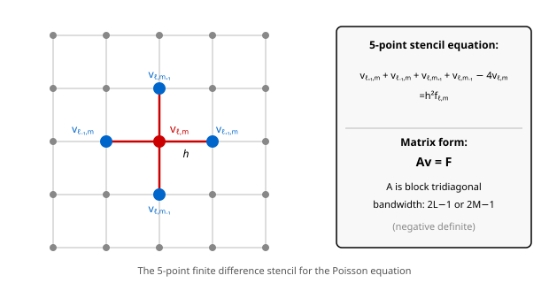

The corresponding matrix $A$ is a banded matrix equation $Av = F$ with bandwidth $2L-1$ (or $2M-1$).

### Structure of the Matrix System

The solution vector $v$ and right-hand side $F$ are assembled by ordering the interior grid points, say row by row (i.e. row-major ordering):

$$
v = \begin{pmatrix} v_{1,1} \\ v_{1,2} \\ \vdots \\ v_{1,M-2} \\ v_{1,M-1} \\ v_{2,1} \\ v_{2,2} \\ v_{2,3} \\ \vdots \\ v_{2,M-1} \\ v_{3,1} \\ \vdots \\ v_{L-1,M-1} \end{pmatrix}, \qquad
F = \begin{pmatrix} h^2 f_{1,1} - v_{0,1} - v_{1,0} \\ h^2 f_{1,2} - v_{0,2} \\ \vdots \\h^2 f_{1,M-2}-v_{0,M-2}\\ h^2 f_{1,M-1}-v_{0,M-1}-v_{1,M}\\ h^2 f_{2,1} - v_{2,0} \\ h^2 f_{2,2} \\ h^2 f_{2,3} \\ \vdots \\ h^2 f_{2,M-1} -v_{2,M} \\ h^2 f_{3,1} - v_{3,0} \\ \vdots \\ h^2 f_{L-1,M-1} -v_{L-1,M}-v_{L,M-1}\end{pmatrix}
$$

Note that while most entries in $F$ are of the form $h^2 f_{\ell,m}$, any sites adjacent to the boundary pick up values of $-v_{\ell\pm 1,m\pm 1}$ that are known (assuming Dirichlet B.C.s) as these are moved to the right-hand side of the equation (i.e. into $F$).  Correspondingly, the bands in $A$ closest to the diagonal that would couple interior points to boundary points have zero entries.

The matrix $A$ is **block tridiagonal**:

$$
A = \left(\begin{array}{cccccc|cccccc|cccccc}
-4 & 1 & 0 & \dots & \dots & 0 &                   1  & 0 & \dots & & \dots & 0     & 0 & \dots & & & &\\
1 & -4 & 1 & \ddots & & \vdots &                   0  & 1 & 0 & & & \vdots & \vdots & & & & &\\
0 & 1 & -4 & 1 & \ddots & \vdots &             \vdots & 0 & 1  & 0 & & & & & & & &\\
\vdots & \ddots  & \ddots & \ddots & \ddots & 0 &    & & \ddots & \ddots & \ddots & \vdots   & & & & & &\\
\vdots &   &  \ddots      & 1 & -4 & 1 &            \vdots & & & 0 & 1 & 0\\
0 & \dots  &   \dots     &  0 & 1  & -4 &           \oslash  & \dots & & \dots & 0 & 1\\\hline
1  & 0 & \dots & & \dots & \oslash &                  -4 & 1 & 0 & & &                  & \ddots & & & & &\\
0  & 1 & 0 & & & \vdots &                       1 & \ddots & \ddots & & &\\ 
\vdots & 0 & 1  & 0 & & &                       0 & \ddots & \ddots & \ddots & & \\
& & \ddots & \ddots & \ddots & \vdots &    \\
\vdots & & & 0 & 1 & 0\\
0 & \dots & & \dots & 0 & 1\\\hline
0 & \dots & & & & & \ddots & & & & & & \ddots\\
\vdots & \\
\\
\\
\\
\\
\end{array}\right)
$$

where the $1$s on off-diagonals connect same-row neighbours, and the $1$s at distance $L-1$ connect vertically adjacent rows. The $\oslash$  entries in the block corners that interupt the 1s just off the main diagonal are where boundary terms were moved to the RHS (i.e. into $F$) and hence these entries are zero.

### Direct Solution with LAPACK: Cholesky Factorisation

The matrix $A$ is **negative definite**. In order to use LAPACK routines (which have specialised routines for positive definite matrices), we instead solve:

$$
(-A)\, v = (-F)
$$

since $-A$ will be **positive definite**. Positive definite matrices are symmetric, so we only need to store the upper triangular part. We can factor $-A$ using **Cholesky factorisation**:

$$
-A = U^T U = L L^T
$$

where $U$, $L$ are upper/lower triangular matrices.  The factorisation can then be used to solve the system of equations. This is a special form of LU factorisation for positive definite matrices.

**Note:** Most of the work is in the factorisation. Once the factorisation is done you can solve for multiple right-hand sides without much extra effort — just change $F$ and use the same factorisation each time (we can call `dpbtrs` each time for this).

The relevant LAPACK routines are:

- `dpbtrf` — `d` for **double**, `p` for **positive definite**, `b` for **band**, and `trf` for **factorize** the band matrix;
- `dpbtrs` — `d` for **double**, `p` for **positive definite**, `b` for **band**, and `trs` for **solve** using the (previously obtained) factorisation

The matrix $-A$ is stored in **band form** and only requires the upper triangular region. It looks like:

```
 x    x   -1  -1  -1  -1 ...   (upper corner marked with x x is ignored, just fill with -1s to fill the band)
 0    0    0  ...
 0    0    0  ...
 :
 0    0    0  ...
 -1  -1  ...   -1  0  -1  -1 - - ...
 4    4  ...    4  4   4  ...
```

where the last row is the main diagonal (all 4s from the $-4$'s in $A$), and the upper rows are the off-diagonal bands.

### C++ Code: PoissonLAPACK.cpp
For this code we assume $L=M=N$ and for $f$ we place two "charges" of opposite sign equally spaced from the centre of the box.
```cpp
#include <iostream>
#include "boost/multi_array.hpp"

// Program to compute solution to -laplacian u = -F
// compile with:
// g++ PoissonLAPACK.cpp -lblas -llapack

// LAPACK library declarations
extern "C" {
  // general band factorize routine
  extern int dpbtrf_(char *, int*, int*, double *, int*, int*);
  // general band solve using factorization routine
  extern int dpbtrs_(char*, int*, int*, int*, double*, int*, double*, int*, int*);
}

void AbInit(int N, boost::multi_array<double,2> &Ab)
{
  // Coefficient Matrix: initialize (band format and switching row/column to put in
  // FORTRAN column major ordering in order to use LAPACK routines)
  for (int i=0; i < N*N; i++) {
    for (int j=0; j< N+1; j++) {
      Ab[j][i]=0.0;   // most entries are zero so set as default
      if (j == 0)
        Ab[j][i] = -1.0;
      if (j == N-1 && (i%N))  // Only 0 when i is divisible by N,
        Ab[j][i] = -1.0;      // exactly where we need the 0s
      if (j == N)
        Ab[j][i] =  4.0;      // main diagonal
    }
  }
}

void RHSInitialize(int N, std::vector<double> &F, double bcx, double bcy)
{
  // RHS: fill in boundary condition values
  for (int i = 0; i < N; i++) {
    F[i]       += bcx;  //bottom boundary
    F[N*N-i-1] += bcx;  //top boundary
    F[i*N]     += bcy;  //left boundary
    F[i*N+N-1] += bcy;  //right boundary
  }

  // RHS: fill in actual right-hand side, some "charges", actually h^2*charge
  F[N/4*N+N/2]   += 0.5;
  F[3*N/4*N+N/2] += -0.5;
}

int main (void)
{
  // Coefficient Matrix: declare
  const int N=100;
  int M = N+1;
  int ABcols = N*N;
  // Only Ab, the banded coefficient matrix, in Fortran form
  boost::multi_array<double,2> Ab(boost::extents[M][ABcols],
                                   boost::fortran_storage_order());

  AbInit(N,Ab);  // Initialize coefficient matrix

  // Coefficient Matrix: factorize
  char uplo = 'U';
  int KD = N;
  int info;
  dpbtrf_(&uplo, &ABcols, &KD, &Ab[0][0], &M, &info);
  if (info) {
    std::cout << "Ab failed to factorize, info = " << info << "\n";
    exit(1);
  }

  // RHS: declare
  const double bcx = 0.0, bcy = 0.0; // boundary conditions same on both sides
  std::vector<double> F(N*N,0.0);

  RHSInitialize(N, F, bcx, bcy); // set up boundary conditions and right hand side

  // Solve system
  int Bcols=1;
  dpbtrs_(&uplo,&ABcols,&KD, &Bcols, &Ab[0][0],&M,&F[0],&ABcols,&info);
  if (info) {
    std::cout << "System solve failed, info = " << info << "\n";
    exit(1);
  }

  // Output solution (ordered in C-style, as discussed in previous chapter)
  for (int i=0; i < N; i++) {
    std::cout << F[i*N];
    for (int j=1; j < N; j++) {
      std::cout << " " << F[i*N+j];
    }
    std::cout << "\n";
  }

  return 0;
}
```
The resulting solution, plotted with Mathematica, looks like:

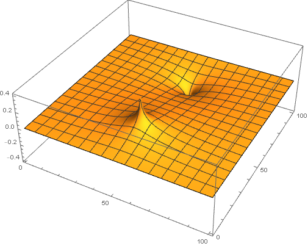

**Note:** If we wanted to move charges around and recompute the potential, we would re-use the factorisation. Only change $F$ and call `dpbtrs` each time you change $F$.

As you will see in the homework, this direct solution becomes increasingly impractical as the system size gets larger and larger. We need to consider something else.

---

## Jacobi Method

Rather than a direct solution, we can try to solve the (large) system of equations iteratively.  One way to do this is to solve the 5-point stencil equation for $v_{\ell,m}$ and iterate:

$$
v_{\ell,m}^{k+1} = \frac{1}{4}\bigl(v_{\ell+1,m}^k + v_{\ell-1,m}^k + v_{\ell,m+1}^k + v_{\ell,m-1}^k\bigr)
$$

for the case were $f=0$.  This is called the Jacobi method and is equivalent to solving $\partial_t u = \nabla^2 u$ using forward-time central-space with $\Delta t = \frac{1}{4}h^2$ and then iterating to steady state.  Note that this is _not_ generally the method you would want to use to solve this problem, but it is easy to understand and implement.  As such, we can focus on the details of how to parallize a code to solve the problem using this method without getting bogged down on details of the method itself.  The parallization technique used is, however, very generalizable to a wide range of problems that can be solved on a regular mesh (or lattice). 

We stop the interations when $|v_{\ell,m}^{k+1} - v_{\ell,m}^k| < \text{tol}$ for **all** sites (referred to as $L_\infty$ or infinity norm for the change in the solution matrix/vector).  We use the $L_\infty$ rather than something like the root mean square error, or $L_2$ norm of the change as the solution converges from the boundaries inward (the boundary values are fixed by the B.C.s).  As such, if you were to start your initial guess with a constant on the domain that is different from the boundary values, in the first sweep over the lattice only the sites adjacent from the boundary will change.  In fact, for an $N\times N$ system it will take $N/2$ iterations for a change near the boundary to propogate all the way to the centre.  As such, convergence is not that fast for this method (which is why if you are really interested in solving this problem you should actually parallize a more sophisticated method such as conjugate gradient which we will discuss towards the end of the chapter).  There are a few simple improvements one can make the the basic Jacobi method that do improve the convergence.

---

## Gauss-Seidel Method

If we go through the mesh in **lexicographic order** (left-to-right, bottom-to-top), then when we come to update $v_{\ell,m}$ in the Jacobi method, we will have already updated $v_{\ell-1,m}$ and $v_{\ell,m-1}$. If we use an **immediate replacement** (i.e. use the updated values as soon as they are available), convergence tends to be faster (by about a factor of 2) and we don't need to keep "old" and "new" values:

$$
v_{\ell,m}^{k+1} = \frac{1}{4}\bigl(v_{\ell+1,m}^k + v_{\ell-1,m}^{k+1} + v_{\ell,m+1}^k + v_{\ell,m-1}^{k+1}\bigr)
$$

This can also be parallized, but usually with rows near processor boundaries still using a Jacobi update (this will be clearer later).

---

## Successive Over-Relaxation (SOR)

Another way to speed things up is to take a "bigger" step towards the solution:

$$
v_{\ell,m}^{k+1} = v_{\ell,m}^k + w\left[\frac{1}{4}\bigl(v_{\ell+1,m}^k + v_{\ell-1,m}^{k+1} + v_{\ell,m+1}^k + v_{\ell,m-1}^{k+1}\bigr) - v_{\ell,m}^k\right]
$$

**Note:** $w = 1 \Rightarrow$ SOR = Gauss-Seidel. Generally we will take $w > 1$ to converge faster.

**How do we pick $w$ for fastest convergence?**

- Typically $1 \leq w \leq 2$ works, so pick something in this range
- It is known that the optimal value (in the sense of fastest convergence) for $w$ for Laplace-like problems generally follows a relation: 

$$
w^* \approx \frac{2}{1 + Ch}
$$

where $C$ is a constant.  To determine $C$ we can use a search algorithm for a small system (large $h$), to find a value of $w\in(1,2)$ for the small system that optimises the convergence (i.e. converges to set error bound in the smallest number of steps.)  Then use the formula and the $h$ to determine the corresponding $C$.  You then use that value for $C$ to determine a value of $w^*$ for the larger system (with smaller $h$).

**NB:** It is better to **overestimate** $w$ than to underestimate.
**NB:** Taking $w$ too large can cause problems in a parallel implementation where "boundary" processors are forced to use Gauss-Seidel.

We could even divide the system into small blocks and solve the small blocks exactly. As the boundary values will be from the previous iteration, we will still need to iterate to convergence. In general, we will end up using some Jacobi/Gauss-Seidel hybrid scheme.

While the Jacobi scheme is not a great algorithm, it is very simple and illustrates how we can parallelise a mesh-based problem.

---

## Parallel Jacobi Method

### 1D Decomposition

Divide the computational mesh along the $y$-direction. Each processor handles a horizontal band of rows.

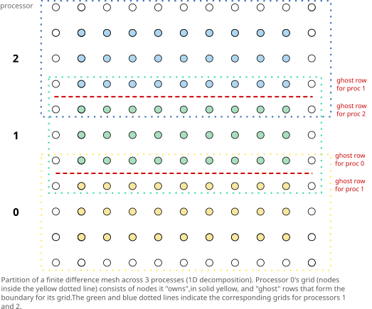

The "boundary" rows that need to be communicated between neighbouring processors are called **ghost rows** (or halo rows). These rows are stored locally by each processor but contain data belonging to its neighbour.  Note that the processors are assigned from bottom to top (0 at the bottom, highest number at top) as we are viewing this as a physical system in a normal right-handed coordinate system where the origin $(0,0)$ is at the lower left, NOT as a mathematical structure like a matrix or computer screen where $\{0,0\}$ would be the upper left.

### Flowchart

To implement the algorithm, we will use a SIMD model so the code on each processor will be the same. 

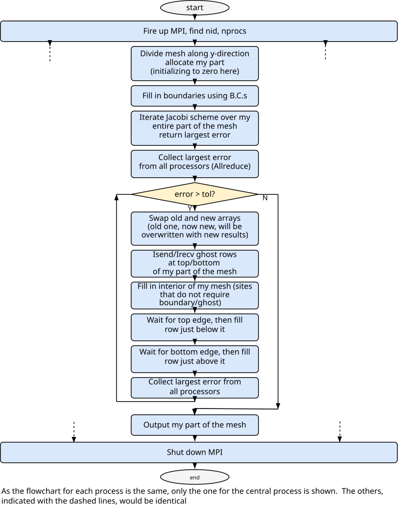 

Key points in the parallel implementation:

- Use **non-blocking** `MPI_Isend`/`MPI_Irecv` to send ghost rows at the top/bottom of each processor's part of the mesh
- While waiting for the ghost rows to arrive, **fill in the interior** of the mesh (sites that do not require the boundary/ghost data)
- Then **wait** for the top edge to arrive and fill the row just below it; similarly wait for the bottom edge and fill the row just above it
- Use `MPI_Allreduce` with `MPI_MAX` to find the global maximum error across all processors

### C Code: PoissonJacobi1DMPI.c

```c
#include <stdio.h>
#include <stdlib.h>
#include <math.h>
#include "mpi.h"

// Solve Poisson's equations using the Jacobi method, with MPI parallelization
// dividing the grid into a 1D array of processors
// Compile with mpicc PoissonJacobi1DMPI.c -lm

#define N   100
#define Tol  0.000001

// MPI Stuff
struct mpi_vars {
  int NProcs;
  int MyID;
};

struct mpi_vars mpi_start(int argc, char** argv)
{
  struct mpi_vars this_mpi;
  MPI_Init(&argc, &argv);
  MPI_Comm_size(MPI_COMM_WORLD, &this_mpi.NProcs);
  MPI_Comm_rank(MPI_COMM_WORLD, &this_mpi.MyID);
  return this_mpi;
}

// breakup array size N in 1D into parts for each processor
int compute_my_size(struct mpi_vars the_mpi)
{
  int remainder = (N - 1) % the_mpi.NProcs;
  int size = (N - 1 - remainder)/the_mpi.NProcs;
  if(the_mpi.MyID < remainder)   // extra rows added for MyID < remainder
    size = size + 2;
  else
    size = size + 1;
  return size;
}

// allocate 2D array as one contiguous block (required for MPI derived data types)
double **matrix(int m, int n)
{
    /* Note that you must allocate the array as one block in order to use */
    /* MPI derived data types on them.  Note also that calloc initializes */
    /* all entries to zero. */
    double ** ptr = (double **)calloc(m, sizeof(double *));
    ptr[0]=(double *)calloc(m*n, sizeof(double));
    for(int i = 1; i < m ;i++)
        ptr[i]=ptr[i-1]+n;
    return (ptr);
}

void initialize(double **old, double **new, int size, struct mpi_vars the_mpi)
{
  /* Assume interior is already initialized, just need to set boundaries */
  /* B.Cs set to a constant, 1 here */
  for(int i = 0; i < size + 1; i++) {
      new[i][0] = old[i][0] = 1;  // left edge
      new[i][N] = old[i][N] = 1;  // right edge
  }
  if(the_mpi.MyID == 0)
    for(int j = 1; j < N; j++)
      new[0][j] = old[0][j] = 1;  // bottom edge
  if(the_mpi.MyID == the_mpi.NProcs - 1)
    for(int j = 1; j < N; j++)
      new[size][j] = old[size][j] = 1;  // top edge
}


double iteration(double **old, double **new, int start, int finish)
{
  /* Jacobi iteration */
  /* start, finish: range of rows to do Jacobi iteration on */
  double maxerr = 0;
  for(int i = start; i < finish; i++) {
    for(int j = 1; j < N; j++) {
      new[i][j] = 0.25*(old[i+1][j] + old[i-1][j] +
                         old[i][j+1] + old[i][j-1]);
      maxerr = fmax(maxerr, fabs(new[i][j] - old[i][j]));
    }
  }
  return (maxerr);
}

void output(double **new, int size, struct mpi_vars the_mpi)
{
  /* Output result */
  /* Each processor will output their piece of the grid to a separate file */
  char str[20];
  FILE *fp;
  sprintf(str,"Solution%d.Txt",the_mpi.MyID);
  fp = fopen(str,"w");
  if(the_mpi.MyID == 0) {
    // processor 0's lower boundary is not a ghost so needs to be output
    for(int j = 0; j < N + 1; j++)
      fprintf(fp,"%6.4f ",new[0][j]);
    fprintf(fp,"\n");
  }
  // output the "owned" sites but NOT the "ghost" sites 
  for(int i = 1; i < size; i++) {
    for(int j = 0; j < N + 1; j++)
      fprintf(fp,"%6.4f ",new[i][j]);
    fprintf(fp,"\n");
  }
  if(the_mpi.MyID == the_mpi.NProcs - 1){
    // top processor's upper boundary is not a ghost so needs to be output
    for(int j = 0; j < N + 1; j++)
      fprintf(fp,"%6.4f ",new[size][j]);
    fprintf(fp,"\n");
  }
  fclose(fp);
}

int main(int argc, char** argv)
{
  struct mpi_vars the_mpi = mpi_start(argc, argv);

  MPI_Status status;
  MPI_Request req_send10, req_send20, req_recv10, req_recv20;

  /* breakup compute grid among processors and initialize*/
  int size = compute_my_size(the_mpi);
  double **new = matrix(size+1, N+1);
  double **old = matrix(size+1, N+1);
  initialize(old, new, size, the_mpi);
  double **tmp; //used for swapping old and new arrays

  /* do one iteration and work out global error */
  double maxerrG;
  double maxerr = iteration(old, new, 1, size);
  MPI_Allreduce(&maxerr, &maxerrG, 1, MPI_DOUBLE, MPI_MAX, MPI_COMM_WORLD);

  /* Main loop */
  while(maxerrG > Tol) {
    tmp = new;
    new = old;
    old = tmp;

    /* send/receive at top of compute block (immediate send/recv, don't wait for response) */
    req_send10 = req_recv20 = MPI_REQUEST_NULL;
    if(the_mpi.MyID < the_mpi.NProcs - 1) {
      MPI_Isend(&old[size-1][1], N-1, MPI_DOUBLE, the_mpi.MyID+1, 10, MPI_COMM_WORLD, &req_send10);
      MPI_Irecv(&old[size][1],   N-1, MPI_DOUBLE, the_mpi.MyID+1, 20, MPI_COMM_WORLD, &req_recv20);
    }
    /* send/receive at bottom of compute block */
    req_send20 = req_recv10 = MPI_REQUEST_NULL;
    if(the_mpi.MyID > 0) {
      MPI_Isend(&old[1][1], N-1, MPI_DOUBLE, the_mpi.MyID-1, 20, MPI_COMM_WORLD, &req_send20);
      MPI_Irecv(&old[0][1], N-1, MPI_DOUBLE, the_mpi.MyID-1, 10, MPI_COMM_WORLD, &req_recv10);
    }

    /* update interior of compute block excluding boundaries adjacent sites which */
    /* are done later after we have recv boundary */
    maxerr = iteration(old, new, 2, size-1);

    /* fill in compute block boundaries adjacent sites as available */
    /* top edge ghost */
    if(the_mpi.MyID < the_mpi.NProcs - 1)
      MPI_Wait(&req_recv20, &status);
    maxerr = fmax(maxerr, iteration(old, new, size-1, size));

    /* bottom edge ghost */
    if(the_mpi.MyID > 0)
      MPI_Wait(&req_recv10, &status);
    maxerr = fmax(maxerr, iteration(old, new, 1, 2));

    /* find global error */
    MPI_Allreduce(&maxerr, &maxerrG, 1, MPI_DOUBLE, MPI_MAX, MPI_COMM_WORLD);
  }

  /* Output result */
  output(new, size, the_mpi);

  free(old[0]); free(old);
  free(new[0]); free(new);
  MPI_Finalize();
  return 0;
}
```

### Results

The solution (using Mathematica's plotting functions) looks like:

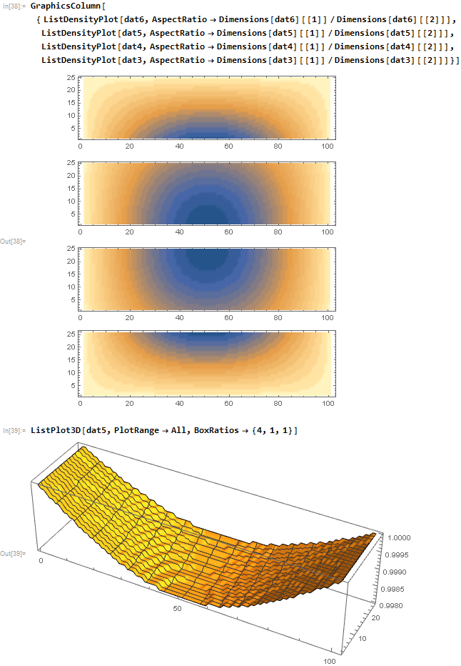

Note that the exact solution here is $u=1$ everywhere.  From the plots we see that

- The solution converges progressively from the boundary inward
- The error $\approx 0.001$ is considerably larger than the change in one iteration (our stopping criteria was a change in one iteration to less than/equal to  `Tol = 0.000001` ).

Note: If we had solved with a direct method (LAPACK), the solution would be exact to machine precision in one step — but that is not practical for large systems.

---

## 2D Decomposition

For a 2D decomposition, we divide the mesh in **both** the $x$- and $y$-directions, giving a grid of processor subdomains:

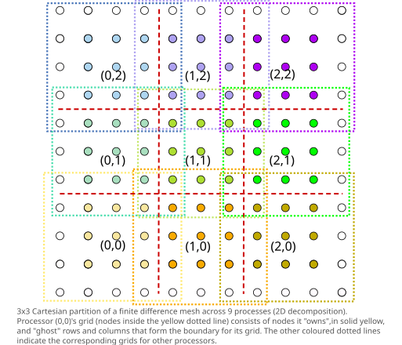

With a $3 \times 3$ grid of processors, we get 9 overlapping subdomains (each with ghost/halo boundaries on all four sides).

Two key problems arise:

**P1:** We need to create a mapping from the list of processors to the topology of the system.
**P2:** If the computer architecture or network has some natural topology matching our problem, we may want to take advantage of it.

How do we do this?

### MPI Cartesian Topology Functions

MPI provides built-in functions for Cartesian decomposition:

**`MPI_Cart_create`** (`MPI_Comm` comm_old, `int` ndims, `int` \*dims, `int` \*periods, `int` reorder, `MPI_Comm` \*comm_cart)

> Makes a new communicator to which topology information has been attached. `MPI_Cart_create` creates a Cartesian decomposition of the processes.
> 
> - `comm_old`: input communicator (handle)
> - `ndims`: number of dimensions of Cartesian grid (integer)
> - `dims`: integer array of size ndims specifying the number of processes in each dimension
> - `periods`: logical array of size ndims specifying whether the grid is periodic (1 = true) or not (0 = false) in each dimension
> - `reorder`: ranking may be reordered (1 = true) or not (0 = false) (logical)
> - `comm_cart`: output communicator to which the new Cartesian topology has been attached.

e.g. to create the  3×3 decomposition like above:
```c
int dims[2] = {3,3};
int isperiodic[2] = {0,0};
MPI_Comm comm2d;
MPI_Cart_create(MPI_COMM_WORLD, 2, dims, isperiodic, 1, &comm2d);
// arguments start with default communicator MPI_COMM_WORLD,
// 2-dimensional decomposition, in a 3x3 grid,
// reorder=1 to take advantage of any system topology,
// our new communicator
```

> **Important:**
> 
>1. `MPI_Comm_rank` should be called **after** the create command, as rank could change with reorder.
>2. The new communicator `comm2d` should now replace `MPI_COMM_WORLD` in MPI commands.

**`MPI_Cart_coords`** (`MPI_Comm` comm, `int` rank, `int` maxdims, `int` \*coords)

> Determines process coords in Cartesian topology given rank in group. `MPI_Cart_coords` takes input as a rank in a communicator and returns the coordinates of the process with that rank. `MPI_Cart_coords` is the inverse to `MPI_Cart_rank`; it returns the coordinates of the process with rank `rank` in the Cartesian communicator comm. Note that both of these functions are local.

**`MPI_Cart_rank`** (`MPI_Comm` comm, `int` \*coords, `int` \*rank)

> Determines process rank in communicator given Cartesian location. `MPI_Cart_rank` returns the rank in the Cartesian communicator comm of the process with Cartesian coordinates. So coordinates is an array with order equal to the number of dimensions in the Cartesian topology associated with comm.

**`MPI_Cart_get`** (`MPI_Comm` comm, `int` maxdims, `int` \*dims, `int` \*periods, `int` \*coords)

> Retrieves Cartesian topology information associated with a communicator. `MPI_Cart_get` retrieves the coordinates of the calling process in communicator.

**`MPI_Cart_shift`** (`MPI_Comm` comm, `int` direction, `int` disp, `int` \*rank_source, `int` \*rank_dest)

> Returns the shifted source and destination ranks given a shift direction and amount. `MPI_Cart_shift` returns rank of source and destination processes in arguments rank_source and rank_dest respectively.

```c
// e.g.
MPI_Cart_shift(comm2d, 0, 1, &nbrleft, &nbrright);
// arguments are: A cartesian communicator, x-direction is 0, step=1,
// processor to left of me (this is the output),
// processor to right of me (also output of this routine)
```

> This allows you to find out who the neighbouring processors are in the topology.

### Sending Column Data in 2D

In the 1D decomposition, we sent boundary **rows** to neighbouring processors. In 2D we will need to send both rows (to upper/lower neighbour) and boundary **columns** to neighbours to right and left.

Sending a row is easy: elements of a row are in consecutive memory locations. This is **not** true of a column.

```c
// e.g. sending a row:
MPI_Isend(&old[size-1][1], N-1, MPI_FLOAT, nid+1, 10, MPI_COMM_WORLD, &req_send10);
// beginning of boundary row, N elements in the row
```

We resolve the problem of sending a column by creating a new **derived data type**:

**`MPI_Type_vector`** (`int` count, `int` blocklength, `int` stride, `MPI_Datatype` oldtype, `MPI_Datatype` \*newtype)
For inputs we have:

- `count`: number of blocks (nonnegative integer)
- `blocklength`: number of elements in each block (nonnegative integer)
- `stride`: number of elements between start of each block (integer)
- `oldtype`: old datatype (handle)
while the output of the routine is
- `newtype`: new datatype (handle)

Once we create a new data type we must **commit** it: 
**`MPI_Type_commit`**(\&newtype) — Tell the system about our new type and optimize for communication.

**Example:** Suppose we have data in a 2D array declared as `double dat[5][7]`. 

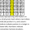

To send a column, say the one indicated in yellow (column index 4), we first define a new type "stridetype" via:

```c
MPI_Type_vector(5, 1, 7, MPI_DOUBLE, &stridetype);
// 5 blocks, 1 element each, stride=7 (row width), MPI_DOUBLE base type
MPI_Type_commit(&stridetype);
```

Now when you want to send the column, you could:

```c
MPI_Isend(&dat[0][4], 1, stridetype, partnercs, tag, commie, &req);
// This is just 1 of this type, and that type gets the whole column
// Note: dat is reinterpreted as of type stridetype
```

**Note the implications of being allowed to do this: there is NO checking you are not overstepping the array bounds.**  Errors from going out of bounds of the array can vary from a program crash to just getting results that are wrong. You are responsible for the memory management here and you need to be _very_ careful with verifying that things are actually working as intended.

### C Code: PoissonJacobi2DMPI.c
Note that in this example, $N\times N$ is the size of the interior grid, which is slightly different from what we did before.

```c
// Solve Poisson's equations using the Jacobi method, with MPI parallelization
// dividing the grid into a 2D array of processors
// Compile line:
// mpicc -O3 PoissonJacobi2DMPI.c -lm -o pois2d

#include <stdio.h>
#include <stdlib.h>
#include <math.h>
#include <float.h>
#include <limits.h>
#include "mpi.h"
#define N  8           /* N x N is size of interior grid */
#define Tol  0.00001

int isperiodic[2]={0,0};  // Flags for periodic boundary conditions are off

// MPI Stuff
struct mpi_vars {
  int NProcs;
  int MyID;
  MPI_Comm D1Comm; // 1D communicator (explicitly add a 1D communicator,
                   // copy of MPI_COMM_WORLD but makes this independent
                   // of any future change to our program
  int nbrdown, nbrup;

  MPI_Comm D2Comm; // 2D communicator
  int dims[2], IDcoord[2]; // processors in each direction in 2D
  int nbrleft, nbrright;
};

struct mpi_vars mpi_start(int argc, char** argv, int dim)
{
  struct mpi_vars mpi;
  MPI_Init(&argc, &argv);

  // We always want a 1D array of processors so just duplicate default
  MPI_Comm_dup(MPI_COMM_WORLD, &mpi.D1Comm);
  MPI_Comm_size(mpi.D1Comm, &mpi.NProcs);

  if (dim == 1) {
    MPI_Comm_rank(mpi.D1Comm, &mpi.MyID);
    mpi.nbrup  = mpi.MyID + 1;
    mpi.nbrdown = mpi.MyID -1;  // (note no bounds check)
    mpi.D2Comm = MPI_COMM_NULL;
  }

  // We sometimes want a 2D array so define if requested
  if (dim == 2) {
    // Find an integer closest to the square root of the processor number
    // attempt to create a square grid of processors (or as close as possible)
    // (obviously if 3, 5, 6, 7 processors will be lost).  Add 2*FLT_EPSILON to avoid 
    // floating point errors and integer arithemetic effectively rounding this down
    mpi.dims[0] = (int) (sqrt(((double)mpi.NProcs))+2.*FLT_EPSILON);
    // Assign as many as possible to other dimension (could leave some unused)
    mpi.dims[1] = mpi.NProcs/mpi.dims[0];

    /* Create Cartesian grid of processors, the new communicator will be used below */
    MPI_Cart_create(MPI_COMM_WORLD, 2, mpi.dims, isperiodic, 1, &mpi.D2Comm);
    MPI_Comm_rank(mpi.D2Comm, &mpi.MyID); //need rank from 2D Comm
    if (mpi.MyID == 0)
      printf("number of processors %i: %i x %i\n",
             mpi.NProcs, mpi.dims[0], mpi.dims[1]);
      
    /* find out who the neighboring processors are */
    MPI_Cart_coords(mpi.D2Comm, mpi.MyID, 2, mpi.IDcoord);
    MPI_Cart_shift(mpi.D2Comm, 0, 1, &mpi.nbrleft,  &mpi.nbrright);
    MPI_Cart_shift(mpi.D2Comm, 1, 1, &mpi.nbrdown,  &mpi.nbrup);
  }

  return mpi;
}

// breakup array size N x N in 2D into parts for each processor
void compute_my_size(int *xsize, int *ysize, struct mpi_vars mpi)
{
  // division along x 
  int xremainder = N  % mpi.dims[0];
  *xsize = (N - xremainder)/mpi.dims[0];
  if(mpi.IDcoord[0] < xremainder)
    *xsize = *xsize + 2;
  else
    *xsize = *xsize + 1;

  // division along y
  int yremainder = N  % mpi.dims[1];
  *ysize = (N - yremainder)/mpi.dims[1];
  if(mpi.IDcoord[1] < yremainder)
    *ysize = *ysize + 2;
  else
    *ysize = *ysize + 1;
    
  // could comment this next line out, but useful for debugging:
  printf("compute grid  size (%i + 1) x (%i + 1) set on processor %i \n",
         *xsize,*ysize,mpi.MyID);
}

// allocate 2D array as one contiguous block
double **matrix(int m, int n)
{
    /* Note that you must allocate the array as one block in order to use */
    /* MPI derived data types on them.  Note also that calloc initializes */
    /* all entries to zero. */
    double ** ptr = (double **)calloc(m, sizeof(double *));
    ptr[0]=(double *)calloc(m*n, sizeof(double));
    for(int i = 1; i < m ;i++)
        ptr[i]=ptr[i-1]+n;
    return (ptr);
}

void initialize(double **old, double **new, int xsize, int ysize, struct mpi_vars mpi)
{
  /* Assume interior is already initialized, just need to set boundaries */
  /* B.C.s set to a constant, 1 here */
  /* left edge */
  if (mpi.IDcoord[0] == 0)
    for (int i=0; i< ysize + 1; i++)
      new[i][0]=old[i][0]=1.0;
  /* right edge */
  if (mpi.IDcoord[0] == mpi.dims[0]-1)
    for (int i=0; i< ysize + 1; i++)
      new[i][xsize]=old[i][xsize]=1.0;
  /* bottom edge */
  if(mpi.IDcoord[1] == 0)
    for(int j = 1; j < xsize+1; j++)
      new[0][j] = old[0][j] = 1.0;
  /* top edge */
  if(mpi.IDcoord[1] == mpi.dims[1] - 1)
    for(int j = 1; j < xsize+1; j++)
      new[ysize][j] = old[ysize][j] = 1.0;

  printf("boundary conditions set on processor %i\n",mpi.MyID);
}

double iteration(double **old, double **new, int xstart, int xfinish,
                  int ystart, int yfinish)
{
  /* Jacobi iteration */
  double maxerr = 0;
  for(int i = ystart; i < yfinish; i++) {
    for(int j = xstart; j < xfinish; j++) {
      new[i][j] = 0.25*(old[i+1][j] + old[i-1][j] +
                          old[i][j+1] + old[i][j-1]);
      maxerr = fmax(maxerr,fabs(new[i][j] - old[i][j]));
    }
  }
  return (maxerr);
}

/* Output result — each processor writes a separate file named result_x_y.txt */
/* taking care to output "ghost" rows/columns ONLY when they correspond to    */
/* actual boundaries. */
void output(double **new, int xsize, int ysize, struct mpi_vars mpi)
{  
  char str[20];
  FILE *fp;

  sprintf(str,"result%d\_%d.txt",mpi.IDcoord[0],mpi.IDcoord[1]);
  fp = fopen(str,"wt");

  if(mpi.IDcoord[1] == 0) {
    if (mpi.IDcoord[0] == 0)
      fprintf(fp,"%6.4f ",new[0][0]);
    for(int j = 1; j < xsize; j++)
      fprintf(fp,"%6.4f ",new[0][j]);
    if (mpi.IDcoord[0] == mpi.dims[0]-1)
      fprintf(fp,"%6.4f ",new[0][xsize]);
    fprintf(fp,"\n");
  }

  for(int i = 1; i < ysize; i++) {
    if (mpi.IDcoord[0] == 0)
      fprintf(fp,"%6.4f ",new[i][0]);
    for(int j = 1; j < xsize; j++)
      fprintf(fp,"%6.4f ",new[i][j]);
    if (mpi.IDcoord[0] == mpi.dims[0]-1)
      fprintf(fp,"%6.4f ",new\[i]\[xsize]);
    fprintf(fp,"\n");
  }

  if(mpi.IDcoord[1] == mpi.dims[1] - 1) {
    if (mpi.IDcoord[0] == 0)
      fprintf(fp,"%6.4f ",new[ysize][0]);
    for(int j = 1; j < xsize; j++)
      fprintf(fp,"%6.4f ",new[ysize\[j]);
    if (mpi.IDcoord[0] == mpi.dims[0]-1)
      fprintf(fp,"%6.4f ",new[ysize][xsize]);
    fprintf(fp,"\n");
  }
  fclose(fp);
}

int main(int argc, char** argv)
{
  // Start MPI with a 2D Cartesian grid of processors
  struct mpi_vars mpi = mpi_start(argc, argv, 2);

  MPI_Status status;
  MPI_Request req_send10, req_send20, req_recv10, req_recv20;
  MPI_Request req_send30, req_send40, req_recv30, req_recv40;

  int maxit=200;

  /* breakup compute grid among processors */
  int xsize, ysize;
  compute_my_size(&xsize, &ysize, mpi);
  double **new = matrix(ysize+1, xsize+1);
  double **old = matrix(ysize+1, xsize+1);
  double **tmp; //used for swapping old and new arrays
  initialize(old, new, xsize, ysize, mpi);

  /* Create data type to send columns of data */
  /* If you didn't get this to work, look at the comment in the matrix
     allocation routine */
  MPI_Datatype stridetype;
  MPI_Type_vector(ysize-1, 1, xsize+1, MPI_DOUBLE, &stridetype);
  MPI_Type_commit(&stridetype);

  /* do one iteration and work out global error */
  double maxerrG;
  double maxerr = iteration(old,new,1,xsize,1,ysize);
  MPI_Allreduce(&maxerr,&maxerrG,1,MPI_DOUBLE,MPI_MAX,mpi.D2Comm);
  if (mpi.MyID == 0) printf("initial error %f\n",maxerrG);

  /* Main loop */
  int iter=0;
  while(maxerrG > Tol && iter < maxit) {
    tmp = new; new = old; old = tmp;  // Swap old and new arrays

    /* send/receive at top of compute block */
    req_send10 = req_recv20 = MPI_REQUEST_NULL;
    if(mpi.IDcoord[1] < mpi.dims[1]-1) {
      MPI_Isend(&old[ysize-1][1], xsize-1, MPI_DOUBLE, mpi.nbrup, 10, mpi.D2Comm, &req_send10);
      MPI_Irecv(&old[ysize][1],   xsize-1, MPI_DOUBLE, mpi.nbrup, 20, mpi.D2Comm, &req_recv20);
    }
    /* send/receive at bottom of compute block */
    req_send20 = req_recv10 = MPI_REQUEST_NULL;
    if(mpi.IDcoord[1] > 0) {
      MPI_Isend(&old[1][1], xsize-1, MPI_DOUBLE, mpi.nbrdown, 20, mpi.D2Comm, &req_send20);
      MPI_Irecv(&old[0][1], xsize-1, MPI_DOUBLE, mpi.nbrdown, 10, mpi.D2Comm, &req_recv10);
    }
    /* send/receive at right of compute block (similar to row interchanges,
       except using stridetype for columns) */
    req_send30 = req_recv40 = MPI_REQUEST_NULL;
    if(mpi.IDcoord[0] < mpi.dims[0]-1) {
      MPI_Isend(&old[1][xsize-1], 1, stridetype, mpi.nbrright, 30, mpi.D2Comm, &req_send30);
      MPI_Irecv(&old[1][xsize],   1, stridetype, mpi.nbrright, 40, mpi.D2Comm, &req_recv40);
    }
    /* send/receive at left of compute block */
    req_send40 = req_recv30 = MPI_REQUEST_NULL;
    if(mpi.IDcoord[0] > 0) {
      MPI_Isend(&old[1][1], 1, stridetype, mpi.nbrleft, 40, mpi.D2Comm, &req_send40);
      MPI_Irecv(&old[1][0], 1, stridetype, mpi.nbrleft, 30, mpi.D2Comm, &req_recv30);
    }

    /* update interior of compute block except beside boundaries */
    maxerr = iteration(old,new,2,xsize-1,2,ysize-1);

    /* fill in compute block beside boundaries as available */
    /* top edge */
    if(mpi.IDcoord[1] < mpi.dims[1]-1) MPI_Wait(&req_recv20,&status);
    maxerr = fmax(maxerr, iteration(old,new,2,xsize-1,ysize-1,ysize));

    /* bottom edge */
    if(mpi.IDcoord[1] > 0) MPI_Wait(&req_recv10,&status);
    maxerr = fmax(maxerr, iteration(old,new,2,xsize-1,1,2));

    /* right edge */
    if(mpi.IDcoord[0] < mpi.dims[0]-1) MPI_Wait(&req_recv40,&status);
    maxerr = fmax(maxerr,iteration(old,new,xsize-1,xsize,1,ysize));

    /* left edge */
    if(mpi.IDcoord[0] > 0) MPI_Wait(&req_recv30,&status);
    maxerr = fmax(maxerr,iteration(old,new,1,2,1,ysize));

    /* find global error */
    MPI_Allreduce(&maxerr,&maxerrG,1,MPI_DOUBLE,MPI_MAX,mpi.D2Comm);
    if (mpi.MyID == 0) printf(" error %f\n",maxerrG);

    iter++;
  }

  /* Output result */
  output(new, xsize, ysize, mpi);

  free(old[0]); free(old);
  free(new[0]); free(new);
  MPI_Finalize();
  return 0;
}
```

The results can be read in and plotted (here using Mathematica). Note: the data must be transposed when plotting because this program expects opposite ordering of rows/columns.

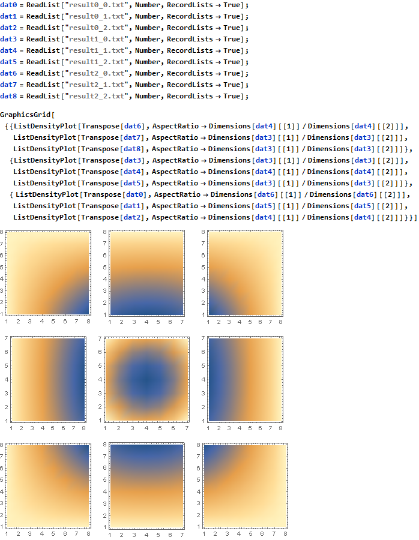


**3×3 grid note on ordering:**

```
10  21  22
10  11  12
00  01  02
```
---

## Output: Writing to a Single Global File

Our output routines are still fairly inadequate. Rather than output each local grid to a separate file, it would be much better to get the complete global grid into a single output file.  There are a couple of issues with doing this:

- We don't actually want the entire local grid, just its interior (i.e. excluding ghost/halo/boundary layers)
-  The local grids may be of unequal size

It usually turns out to be easier to adjust the lattice spacing ($\Delta x$ or $h$) to ensure all local grids are the same size than to have to deal with different sizes, so we will assume they are all the same.

You actually have two very distinct **masks** to consider:

1. The mask for the local data, excluding the halo layers
2. The mask for the global data, as it should be once collated into the file

The former corresponds to the **local grid on a single processor** (the interior cells in dark, the ghost layer in light).

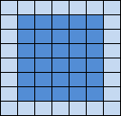

The start of the interior data is at index `[1,1]`,  which if interpreted as a location in physical space is in the lower left.  Here, the data you want to output is in dark blue, and the ghost layer that should not be written is in ligher blue.  The latter corresponds to how the **global mesh is assembled from a 2D grid of processors** (each colour corresponds to the local data from a different process). For example for a $2\times 2$ processor grid:

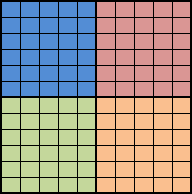

Here, each colour represents local data coming from a different process, as organized onto a 2D Cartesion grid.

To understand what you need to create, you have to think backwards:

1. Your final call to the I/O routine will be:
   ```c
   MPI_File_write_all(fh, &A[0][0], 1, interior, MPI_STATUS_IGNORE);
   ```
   So you need the interior type defined to exclude the halo boundary. We will define an MPI type grid to do this. File functions will be discussed below.
2. But now you have to have the view on the file to allow for this `MPI_File_write_all` call. So the view must be as described in the second picture. We will therefore create a new MPI type representing it. For that, `MPI_Type_create_subarray` is what we need.

### `MPI_Type_create_subarray`
This routine creates a datatype for a subarray of a regular, multidimensional array.

```c
int MPI_Type_create_subarray(int ndims,
                              const int array_of_sizes[],
                              const int array_of_subsizes[],
                              const int array_of_starts[],
                              int order,
                              MPI_Datatype oldtype,
                              MPI_Datatype *newtype)
```

**Input Parameters:**

- `ndims` — number of array dimensions (positive integer)
- `array_of_sizes` — number of elements of type oldtype in each dimension of the full array (array of positive integers)
- `array_of_subsizes` — number of elements of type oldtype in each dimension of the subarray (array of positive integers)
- `array_of_starts` — starting coordinates of the subarray in each dimension (array of nonnegative integers)
- `order` — array storage order flag (state)
- `oldtype` — array element datatype (handle)
  
**Output Parameters:**

- `newtype` — new datatype (handle)

**Weaknesses of `MPI_Type_create_subarray`:**

- At first sight, `MPI_Type_create_subarray` looks like it solves all problems, but it has problems all of its own
- Array of sizes must be the same on every process
- Array of subsizes must be the same on every process
- Therefore, `MPI_Type_create_subarray` is simply to do uniform, even subdivision of an array, with an identical fraction of the array being defined on each processor
- In fact, its main purpose is in MPIIO, where it is used to represent the subsection of a global array held by each processor
- It does still work in communication, although it's not quite as useful as it might be.


For our Jacobi solver using a 2D array of processors, the **local subarray type** is defined by:

```c
/* Create derived datatype for local interior grid (output grid) */
MPI_Datatype grid;
int start[2]  = {1, 1};  // indices of interior "origin"
int arrsize[2]  = {xsize+1, ysize+1};   // full local array size
int gridsize[2] = {xsize+1 - 2, ysize+1 - 2};  // size of interior

MPI_Type_create_subarray(2, arrsize, gridsize,
                          start, MPI_ORDER_FORTRAN, MPI_DOUBLE, &grid);
MPI_Type_commit(&grid);
```

**Note:** We picked `MPI_ORDER_FORTRAN` rather than `MPI_ORDER_C`. This is because we pick our indices as `A[y-index][x-index]` which is consistent with `A[row-index][column-index]` for a matrix (except that row-index=0 is at the top and y-index=0 is at the bottom). However, when interpreted as spatial indices, C-order is assumed to be `A[x][y]`, so our order is actually the Fortran equivalent.

For our global array we also need a subarray type describing how the local grids fit into the global grid:

```c
/* Create derived type for file view, how local interior fits into global system */
MPI_Datatype view;
int nnx = xsize+1-2, nny = ysize+1-2;
int startV[2]  = { mpi.IDcoord[0]*nnx, mpi.IDcoord[1]*nny };
int arrsizeV[2] = { mpi.dims[0]*nnx, mpi.dims[1]*nny };
int gridsizeV[2] = { nnx, nny };

MPI_Type_create_subarray(2, arrsizeV, gridsizeV,
                          startV, MPI_ORDER_FORTRAN, MPI_DOUBLE, &view);
MPI_Type_commit(&view);
```

We will use this type for the "file view", applied simply with:

```c
MPI_File_set_view(fh, 0, MPI_DOUBLE, view, "native", MPI_INFO_NULL);
```

and the magic is done.

### MPIIO Overview

**MPIIO Advantages:**

- Improved output speed in large parallel environments
- Output to a single file for any number of processors (easily)

**MPIIO Disadvantages:**

- Syntax is not exactly like either C or FORTRAN IO (although similar in concept)
- Can be slower on desktop machines
- Produces C type binary output

**MPIIO Concepts:**

- In most senses MPIIO is the same as conventional binary IO
- There are commands to open and close files, read and write data and move file pointers
- There are things called file views which describe the layout of data across processors
- There are some commands to help with writing simple data layouts more easily than using file views, but they will not be covered here
- File views are described using MPI_types

#### Key MPIIO Functions
```c
int MPI_File_open(MPI_Comm Comm, char *filename, int amode, MPI_Info info, MPI_File *mpi_fh)
```
> **Description:** Opens a file using MPIIO and returns a file handle mpi_fh.
> 
> - This is a **collective** operation. All processes must have the same `amode` and the `filename` must reference the same file (does not have to be the same filename)
> - Choosing whether opening the file for reading or writing is via constants passed as part of `amode` as normal
> - `info` is used to pass additional parameter, which will generally vary from system to system. You create MPI Info objects using the MPI Info commands. Most generally, you can use `MPI_INFO_NULL` to open the file generically.
> 
> **MPI File open modes:**
> 
> - `MPI_MODE_RDONLY` — Open for reading
> - `MPI_MODE_RDWR` — Open for reading and writing
> - `MPI_MODE_WRONLY` — Open for writing
> - `MPI_MODE_CREATE` — Create the file if it does not exist
> - `MPI_MODE_EXCL` — Throw error if file exists
> - `MPI_MODE_DELETE_ON_CLOSE` — Delete the file when it's closed
> - `MPI_MODE_UNIQUE_OPEN` — Throw error if file opened anywhere else
> - `MPI_MODE_SEQUENTIAL` — Sequential mode (tapes etc.)
> - `MPI_MODE_APPEND` — Set initial position of all file pointers to end of file

```c
int MPI_File_close(MPI_File *mpi_fh)
```
> **Description:** Closes and frees the file handle `mpi_fh`. File handles must be closed before MPI is finalized. Otherwise behaviour is undefined.

```c
int MPI_File_write_all(MPI_File mpi_fh, void *buf, int count, MPI_Datatype datatype, MPI_Status *status)
```
> **Description:** Writes to the file pointed to by the handle mpi_fh using the individual file pointer.
> 
> - This is a **collective** operation and all the processors in the MPI_Comm given to MPI_File_open must call MPI_File_write_all or the code will lock (i.e. this is a blocking operation).

**What are file views?**

- If you wish to have more control over where a given processor will write its data then you have to use file views
- File views use MPI types to describe the section of the global data that the current processor has, and its location in the final file on disk
- Makes it easier to write multidimensional arrays into a single file
```c
int MPI_File_set_view(MPI_File mpi_fh, MPI_Offset offset, MPI_Datatype etype, MPI_Datatype filetype, MPI_Datatype datarep, MPI_Info info)
```
> **Description:** Sets the file view on file handle mpi_fh.
> 
> - `offset` is the offset from the start of the file at which to apply the file view
> - `datarep` is a string describing the data representation, usually `"native"`
> - `info` contains additional information, will usually be `MPI_INFO_NULL`
> - `etype` is the basic datatype being written to the file
> - `filetype` is (normally) a derived datatype which describes the layout of the data for the current processor on the disk

### Final Output Routine

So our final output routine will be:

```c
void output_onefile(double **new, int xsize, int ysize, struct mpi_vars mpi)
{
  /* Create derived datatype for local interior grid (output grid) */
  MPI_Datatype grid;
  int start[2]  = {1, 1};   // indices of interior "origin"
  int arrsize[2]  = {xsize+1, ysize+1};   // full local array size
  int gridsize[2] = {xsize+1 - 2, ysize+1 - 2};  // size of interior

  MPI_Type_create_subarray(2, arrsize, gridsize,
                            start, MPI_ORDER_FORTRAN, MPI_DOUBLE, &grid);
  MPI_Type_commit(&grid);

  // Create derived type for file view, how local interior fits into global system
  MPI_Datatype view;
  int nnx = xsize+1-2, nny = ysize+1-2;
  int startV[2]  = { mpi.IDcoord[0]*nnx, mpi.IDcoord[1]*nny };
  int arrsizeV[2] = { mpi.dims[0]*nnx, mpi.dims[1]*nny };
  int gridsizeV[2] = { nnx, nny };

  MPI_Type_create_subarray(2, arrsizeV, gridsizeV,
                            startV, MPI_ORDER_FORTRAN, MPI_DOUBLE, &view);
  MPI_Type_commit(&view);

  /* MPI IO */
  MPI_File fp;
  MPI_File_open(mpi.D2Comm, "output.bin", MPI_MODE_CREATE | MPI_MODE_WRONLY,
                MPI_INFO_NULL, &fp);

  MPI_File_set_view(fp, 0, MPI_DOUBLE, view, "native", MPI_INFO_NULL);
  MPI_File_write_all(fp, &new[0][0], 1, grid, MPI_STATUS_IGNORE);
  MPI_File_close(&fp);
}
```

**Note:** This should only be used when all local grids are the same size. With `xremainder = yremainder = 0` in Jacobi 2D, this gives a single binary output file that can be read and plotted directly as illustrated below.

**Note:** Output is now in **binary**, not text.

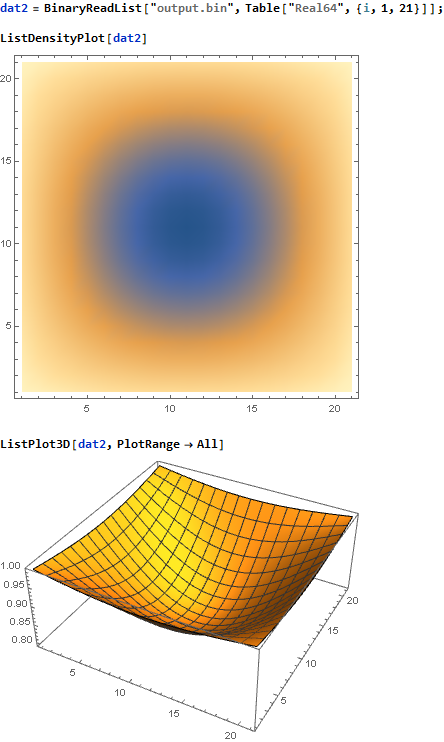

---

## Conjugate Gradient Method

The Jacobi method is a nice illustration of how to parallize a problem defined on a computational mesh.  It is NOT, however, an algorithm that is terribly efficient for actually solving Poission's equation.  We now turn to a much better iterative algorithm for solving this problem, namely the **Conjugate Gradient (CG) Method**.  This requires more background in order to understand the algorithm, but parallizing the algorithm requires very similar steps to what was used to parallize the Jacobi algorithm.

### Mathematical Background

Suppose $\mathcal{A}$ is positive definite. Consider the scalar quadratic function with vector arguments:

$$
f({\bf x}) = \frac{1}{2} {\bf x}^T \mathcal{A} {\bf x} - {\bf b}^T {\bf x} + c = \frac{1}{2} x_\alpha A_{\alpha\beta} x_\beta - b_\alpha x_\alpha + c
$$

where tensor notation with summation convention assumed is used after the 2nd equality sign.  Here $x_\alpha$ is a component of ${\bf x}$, and $A_{\alpha\beta}$ is a matrix element of the matrix $\mathcal{A}$.  Taking the derivative with respect to $x_\gamma$ gives:

$$
\frac{\partial f}{x_\gamma} = \frac{1}{2} \delta_{\gamma\alpha} A_{\alpha\beta} x_\beta + \frac{1}{2} x_\alpha A_{\alpha\beta} \delta_{\beta\gamma} - b_\gamma \delta_{\gamma\gamma}
= A_{\gamma\beta} x_\beta - b_\gamma
= (\mathcal{A}{\bf x} - {\bf b})_\gamma
$$

so that $\nabla f = \mathcal{A}{\bf x} - {\bf b}$.  Minimizing $f$ is equivalent to solving $\partial f/\partial x_\gamma = 0$ for all $\gamma$ and is therefore equivalent to solving $\mathcal{A}{\bf x} = {\bf b}.$  (The fact that there is a minimum is guaranteed by the fact that $\mathcal{A}$ is positive definite.)

### Line Search

We try to find approximate ways to minimise $f$ via an iteration scheme:

$$
x_\alpha^{(m+1)} = x_\alpha^{(m)} + \lambda_m d_\alpha^{(m)}
$$

where $m$ is the iteration label and $\alpha$ is the vector coordinate index.  The idea will be to pick the scalar $\lambda_m$ to minimise $f$ along the line determined by some vector ${\bf d}^{(m)}$ (the search direction).

$$
\begin{align}
f({\bf x}^{(m)} + \lambda {\bf d}^{(m)}) &= \frac{1}{2}(x_\alpha + \lambda d_\alpha) A_{\alpha\beta}(x_\beta + \lambda d_\beta) - b_\alpha(x_\alpha + \lambda d_\alpha) + c\\ 
&= f({\bf x}^{(m)}) + \lambda^2\!\left(\frac{1}{2} d_\alpha A_{\alpha\beta} d_\beta\right) + \lambda\, d_\alpha\bigl(A_{\alpha\beta} x_\beta - b_\alpha\bigr)
\end{align}
$$

where we have used the fact that $\mathcal{A}$ is symmetric so $d_\alpha A_{\alpha\beta} x_\beta = x_\alpha A_{\alpha\beta} d_\beta$.  Note that the first term is just a number and the second term is greater than zero due to the fact that $\mathcal{A}$ is positive definite so this defines an upward parabola if plotted as a function of $\lambda$.  We define the **residual** (the gradient of $f$ at ${\bf x}^{(m)}$) as 

$${\bf r}^{(m)} = \mathcal{A}{\bf x}^{(m)} - {\bf b}.$$

Minimizing $f$ along our search direction is then at $\partial f / \partial \lambda = 0$:

$$
\lambda\, d_\alpha A_{\alpha\beta} d_\beta + d_\alpha r_\alpha^{(m)} = 0
\quad \Rightarrow \quad
\lambda_{min} = -\frac{d_\alpha^{(m)} r_\alpha^{(m)}}{d_\alpha^{(m)} A_{\alpha\beta} d_\beta^{(m)}}
$$

to get to the minimum along our line.

### Choosing the Search Direction

What direction should we search in? It makes sense to take ${\bf d}^{(0)}$ along the gradient $\nabla f({\bf x}^{(0)}) = -{\bf r}^{(0)}$, i.e. in the downhill direction. Subsequent searches are along:

$$
{\bf d}^{(m+1)} = -{\bf r}^{(m+1)} + \alpha_m {\bf d}^{(m)}
$$

where $-{\bf r}^{(m+1)}$ is the gradient at the current minimum and $\alpha_m {\bf d}^{(m)}$ removes directions we have just searched.
**How?** Choose ${\bf d}^{(m+1)}$ to be **$\mathcal{A}$-conjugate** to ${\bf d}^{(m)}$, i.e. so that

$$
d_\alpha^{(m+1)} A_{\alpha\beta} d_\beta^{(m)} = 0.
$$

You can think of this as choosing ${\bf d}^{(m+1)}$ to be orthogonal to ${\bf d}^{(m)}$ in a space where $\mathcal{A}$ is a metric.
Substituting:

$$
\bigl(-r_\alpha^{(m+1)} + \alpha_m d_\alpha^{(m)}\bigr) A_{\alpha\beta} d_\beta^{(m)} = 0
\quad \Rightarrow \quad
\alpha_m = \frac{r_\alpha^{(m+1)} A_{\alpha\beta} d_\beta^{(m)}}{d_\alpha^{(m)} A_{\alpha\beta} d_\beta^{(m)}}
$$

### Conjugate Gradient Algorithm

Before writing down the full algorithm, a few simplifications are possible by noting that it is not too hard to show that

i) $d_\alpha^{(m)} r_\alpha^{(m+1)} = 0$  — i.e. previous search direction and new residual are orthogonal

ii) $r_\alpha^{(m)} r_\alpha^{(\ell)} = 0$ for $m \neq \ell$  — i.e. all residuals are orthogonal (we are eliminating residuals along a new specific direction at every step)

iii) With i) and ii), it is possible to show:

$$
\lambda_m = \frac{r_\alpha^{(m)} r_\alpha^{(m)}}{d_\alpha^{(m)} A_{\alpha\beta} d_\beta^{(m)}}, \qquad \alpha_m = \frac{r_\alpha^{(m+1)} r_\alpha^{(m+1)}}{r_\beta^{(m)} r_\beta^{(m)}}
$$

To save repeating work,  $\delta^{(m+1)} = r_\alpha^{(m+1)} r_\alpha^{(m+1)}$ should be saved for the next step (where it will be used as $\delta^{(m)}$), and since ${\bf r}^{(m+1)} = {\bf r}^{(m)} + \lambda_m {\bf u}$ (where ${\bf u} = \mathcal{A}{\bf d}^{(m)}$, the same matrix-vector product already computed for $\lambda_m$), we can avoid re-computing $\mathcal{A}{\bf d}^{(m+1)}-{\bf b}$ from scratch.

The full algorithm then becomes:

---

$$
\begin{align}
&{\bf r}^{(0)} = \mathcal{A}{\bf x}^{(0)} - {\bf b}; \quad {\bf d}^{(0)} = -{\bf r}^{(0)}; \quad \delta^{(0)} = {\bf r}^{(0)T} {\bf r}^{(0)};\\
&\text{for } m = 0, 1, 2, \ldots\\
&\qquad {\bf u} = \mathcal{A}{\bf d}^{(m)}; \quad \leftarrow \text{matrix-vector product (the main parallelisable kernel)}\\
&\qquad \lambda_m = \frac{\delta^{(m)}}{{\bf d}^{(m)T} {\bf u}}; \quad \leftarrow \text{do locally then AllReduce}\\
&\qquad {\bf x}^{(m+1)} = {\bf x}^{(m)} + \lambda_m {\bf d}^{(m)};\\
&\qquad {\bf r}^{(m+1)} = {\bf r}^{(m)} + \lambda_m {\bf u};\\
&\qquad \delta^{(m+1)} = {\bf r}^{(m+1)T} {\bf r}^{(m+1)}; \quad \leftarrow \text{do locally then AllReduce}\\
&\qquad \text{if } \sqrt{\delta^{(m+1)}} < \text{tol}: \text{ output } {\bf x}^{(m+1)}, \text{ stop};\\
&\qquad \alpha_m = \frac{\delta^{(m+1)}}{\delta^{(m)}};\\
&\qquad {\bf d}^{(m+1)} = -{\bf r}^{(m+1)} + \alpha_m {\bf d}^{(m)}; \quad \leftarrow \text{local}
\end{align}
$$

---

### How Many Iterations Are Needed?

**Not many!** Suppose the initial guess is ${\bf x}^{(0)} = \mathbf{0}$, then:

$$
{\bf x}^{(m)} = \sum_{k=0}^{m} c_k {\bf d}^{(k)}
$$

But all ${\bf d}^{(k)}$ are linearly dependent, by construction. If $\mathcal{A}$ is $n \times n$, then we can need at most $n$ iterations, and then should terminate. For well-conditioned problems, much fewer iterations are needed.

### C Code: CG.c
A serial code for the conjugate gradient algorithm in C is given here for solving Laplace's equation.  Note that in this case $\mathcal{A}$ is very sparse so you should not store it explicitly.  As $\mathcal{A}$ is only used in computing $\mathcal{A}{\bf d}^{(m)}$ we can do this multiplication explictly using the five nonzero elements in a row of $\mathcal{A}$ associated with the 5-point stencil discussed above.  Also, for this problem ${\bf x}$ is our solution vector ${\bf v}$ on the mesh, stored in row-major ordering.

```c
/* Compile line: */
/*   gcc -O3 CG.c -lm   */
#include <stdio.h>
#include <stdlib.h>
#include <math.h>

#define N  500
#define Tol  0.0001
#define maxitr 2*N
#define h 0.1

double **matrix(int m, int n)
{
  /* Note that you must allocate the array as one block in order to use */
  /* MPI derived data types on them.  Note also that calloc initializes */
  /* all entries to zero. */
  double ** ptr = (double **)calloc(m, sizeof(double *));
  ptr[0]=(double *)calloc(m*n, sizeof(double));
  for(int i = 1; i < m ;i++)
    ptr[i]=ptr[i-1]+n;
  return (ptr);
}

void initialize(double ** r, double **x, int size)
{
  /* Subtract off b from a particularly boring set of boundary conditions
     where x=1 on the boundary */
  for(int i = 1; i < size; i++) {
    r[i][1]    -= 1;
    r[i][size-1] -= 1;
    x[i][0]=1;     // we won't use x on the boundary but useful for output at end
    x[i][size]=1;
  }
  for(int j = 1; j < size; j++) {
    r[1][j]    -= 1;
    r[size-1][j] -= 1;
    x[0][j]=1;
    x[size][j]=1;
  }
  x[0][0]=x[0][size]=x[size][0]=x[size][size]=1; /* fill in the corners */
}

// Compute Ad = A*d using auxiliary layer around the outside that is all zero
// (similar to iteration routine in Jacobi algorithm; Ad similar to "new", d similar to "old")
void AD(double **Ad, double **d, int start, int finish)
{
  int i, j;
  for(i = start; i < finish; i++) {
    for(j = 1; j < N; j++) {
      Ad[i][j] = -(d[i+1][j] + d[i-1][j] + d[i][j+1] + d[i][j-1]-4.0*d[i][j]);
    }
  }
  return;
}

void output(double **x, int size)
{
  char str[20];
  FILE *fp;
  sprintf(str,"Solution.Txt");
  fp = fopen(str,"wt");
  for(int i = 0; i < size+1; i++) {
    for(int j = 0; j < size + 1; j++)
      fprintf(fp,"%6.4f\n",x[i][j]);
  }
  fclose(fp);
}

int main(int argc, char** argv)
{
  double delta, lambda, olddelta, alpha;

  /* create arrays and initialize to all zeros */
  /* Note: Although these are column vectors in the algorithm, they represent */
  /* locations in 2D space so it is easiest to store them as 2D arrays */
  double **x = matrix(N+1,N+1);
  double **r = matrix(N+1,N+1);
  double **d = matrix(N+1,N+1);
  double **u = matrix(N+1,N+1);

  /* Work out A x(0), note that we make use of the x being zero on the boundary */
  /* so we don't need the boundaries to be special cases in the iteration */
  AD(r,x,1,N);

  initialize(r,x,N); // setup boundary conditions (from the -b part of r=Ax-b)

  /* Fill in d */
  for (int i=1; i<N; i++)
    for (int j=1; j<N; j++)
      d[i][j]=-r[i][j];

  /* Compute first delta */
  delta=0.0;
  for (int i=1; i<N; i++)
    for (int j=1; j<N; j++)
      delta+= r[i][j]*r[i][j];
  printf("itr = %i delta = %g\r",0,delta);

  /* Main loop */
  int itr;
  for (itr=0; itr< maxitr; itr++) {
    AD(u,d,1,N); // this could be parallelized similar to Jacobi, with new<=>u, old<=>d

    lambda=0.0;
    for (int i=1; i<N; i++)
      for (int j=1;j<N; j++)
        lambda+= d[i][j]*u[i][j];
    lambda=delta/lambda; // would need to collect/sum results here with an AllReduce

    // local, no change for parallelization:
    for (int i=1; i<N; i++) {
      for (int j=1;j<N; j++) {
        x[i][j] += lambda*d[i][j];
        r[i][j] += lambda*u[i][j];
      }
    }

    olddelta=delta;
    delta=0.0;
    for (int i=1; i<N; i++)
      for (int j=1; j<N; j++)
        delta+= r[i][j]*r[i][j];
    printf("itr = %i delta = %g\r",itr,delta);

    if (sqrt(delta) < Tol)
      break;

    alpha=delta/olddelta;
    // local, no change for parallelization:
    for (int i=1; i<N; i++) {
      for (int j=1;j<N; j++) {
        d[i][j] = -r[i][j]+alpha*d[i][j];
      }
    }
  }

  printf("\nComplete in %d iterations \n",itr);

  /* Output result */
  output(x,N);

  free(r[0]); free(r);
  free(d[0]); free(d);
  free(u[0]); free(u);
  free(x[0]); free(x);
  return 0;
}
```

### Parallelisation of the CG Method

Parallelisation of this code is very similar to what we did before:

1. The "matrix-vector" product for the case where $\mathcal{A}$ is defined from the Poisson equation is almost identical to what we did for an "iteration" of the Jacobi algorithm.

2. Most other computations are **local** except for a few dot products/norms which can easily be done locally and then collected together using an `MPI_Allreduce`.
